# ML-Driven PVT-Variation-Aware Leakage Estimation

**Digital VLSI Design — course project report.** Team: Saumya Vira, Anish Toshniwal, Shrenil Patel, Het Selarka. Technology: PTM 45 nm HP (metal gate / high-k), VDD = 1 V; test circuit: 3-bit carry-lookahead adder. Report generated 2026-11-13 from the project's result files by `scripts/z3_build_report.py`.

## Abstract

Leakage current of CMOS logic under process, voltage and temperature (PVT) variation is estimated with machine learning instead of full SPICE simulation. Four transistor-level models (NMOS/PMOS, ON/OFF) predict all four terminal currents (Id, Ig, Is, Ib) from VDD, temperature, width, terminal voltages and five BSIM4 process parameters. Trained on 40,000 SPICE samples (plus 24,000 targeted samples), they are composed hierarchically into gate models (INV, NAND2, NOR2, AND2, OR2) and into a 36-gate, 192-transistor 3-bit carry-lookahead adder. On an independent evaluation set (200 new PVT corners) the hierarchical estimate of the full adder's leakage has a median error of 0.57 %, a 95th-percentile error of 2.26 % and a mean accuracy of **99.24 %**; individual gates reach 98.93 % and transistors (spec distribution) 98.56 %. The 99 % mean-accuracy target is therefore met at circuit level but not at gate or transistor level.

## 1. Introduction and objectives

Static (leakage) power is a first-order design concern in nanometre CMOS, and it varies by orders of magnitude with temperature, supply voltage and manufacturing variation. Characterising it with SPICE at every corner and input state is expensive. The project builds a hierarchical ML estimator: (A) learn transistor terminal currents from SPICE, (B) predict gate leakage from those transistor models and validate against transistor-level gate SPICE for all 18 gate/input cases at 200 corners, (C) compose a larger circuit from the gate models and validate against full-circuit SPICE. The stated target is up to 99 % mean accuracy.

## 2. Assigned technology, VDD and test circuit

| item | value |
|---|---|
| Model file | `models/45nm_HP.pm` (PTM 45 nm HP, BSIM4 level 54) |
| Nominal VDD | 1 V (sampled 0.9–1.1 V) |
| Channel length | L = 45 nm |
| Widths | 45–360 nm (1–8 Lmin) |
| Test circuit | 3-bit carry-lookahead adder (Cin = 0, 64 vectors) |

## 3. Setup: SPICE simulator and environment

ngspice 44.2 (console build `ngspice_con.exe`), batch mode, driven from Python 3.13.14 on Windows 11 (numpy 2.5.4, pandas 3.1.1, scikit-learn 1.9.1, LightGBM 4.7.0, PyTorch 2.8.0 CPU for the final training). Every netlist (transistor, gate, circuit) contains `.options gmin=1e-18 abstol=1e-18 reltol=1e-6 vntol=1e-9`; single-transistor netlists drive every terminal with its own voltage source. Results are read from ngspice ASCII raw files (full double precision), not from printed logs. Currents are positive *into* the device terminal (I = −i(V_source)). Process variation is written into a fresh model card per sample: `altermod toxe` was found not to recompute the oxide-dependent BSIM4 terms in ngspice 44.2 (errors up to ≈5×). Isolated non-converging circuits are retried with raised DC iteration limits (tolerances unchanged).

## 4. PVT sampling methodology

Per transistor sample, independently: VDD ~ U(±10%) drawn first; Vd, Vs ~ U(0, VDD); W ~ U(1–8 Lmin); T ~ U(-40, 125) °C; vth0, toxe, ndep, u0, xj ~ U(±10%) of the device's own nominal value. Vg/Vb follow the case: NMOS ON (VDD, 0), NMOS OFF (0, 0), PMOS ON (0, VDD), PMOS OFF (VDD, VDD). Sample k is drawn from `default_rng([case_seed, k // 1000])`, so every sample is reproducible on its own. Seeds: data 1001 (+100 per case), split 2002, training 3003, gate/circuit corners 4004 (independent evaluation corners 5005). A corner draws VDD, T, one NMOS and one separate PMOS set of the five parameters, shared by all devices of that type.

## 5. Data generation and quality checks

40,000 single-transistor simulations, 40,000 succeeded, 0 failed; regenerating from scratch reproduced the four CSVs byte-for-byte. Supplementary targeted samples (near-rail terminals, |Vds| from 1 nV) were generated later for training only (4,000 + 4,000 per ON case, 2,000 + 2,000 per OFF case; separate files). Kirchhoff check (sum of the four terminal currents):

| case | max |ΣI| (A) | median |ΣI| (A) | p95 |ΣI| (A) | over tolerance |
|---|---|---|---|---|
| nmos_on | 1.90e-15 | 7.75e-17 | 3.55e-16 | 0 |
| nmos_off | 1.87e-23 | 4.19e-27 | 1.89e-25 | 0 |
| pmos_on | 1.86e-16 | 3.03e-17 | 8.78e-17 | 0 |
| pmos_off | 1.51e-15 | 8.82e-17 | 3.90e-16 | 0 |

The largest residuals (~1e-15 A) occur only when all four currents are tiny; they do not depend on gmin, reltol or vntol and are a fixed BSIM4 non-conservation. Physical trends, conditioned so that the independently randomised inputs do not hide them (|Vds| ≥ 0.5·VDD and source within 0.05·VDD of its rail for OFF current; gate-to-channel bias for Ig), with partial-regression slopes vs controlled SPICE sweeps:

| trend | device | unit | dataset (other inputs fixed) | controlled SPICE sweep |
|---|---|---|---|---|
| OFF \|Id\| vs temperature | nmos | decades per 10 C | +0.112 | +0.093 |
| OFF \|Id\| vs \|vth0\| | nmos | decades per 10 mV | -0.115 | -0.113 |
| ON \|Ig\| vs toxe | nmos | decades per 0.1 nm | -0.664 | -0.651 |
| ON \|Ig\| vs temperature | nmos | decades per 10 C | +0.015 | – |
| OFF \|Id\| vs temperature | pmos | decades per 10 C | +0.104 | +0.086 |
| OFF \|Id\| vs \|vth0\| | pmos | decades per 10 mV | -0.099 | -0.108 |
| ON \|Ig\| vs toxe | pmos | decades per 0.1 nm | -0.588 | -0.585 |
| ON \|Ig\| vs temperature | pmos | decades per 10 C | +0.003 | – |

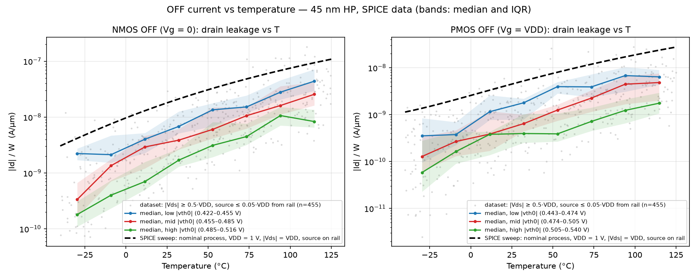

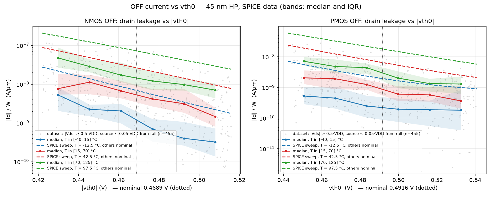

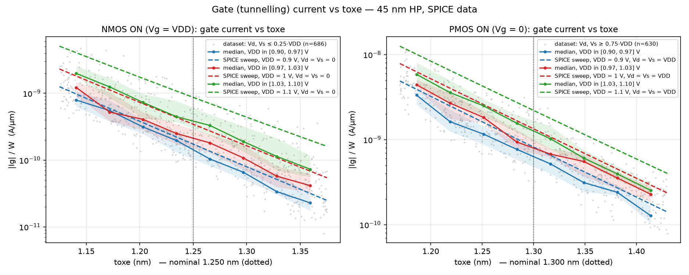

Data-check findings: OFF current falls about one decade per 0.1·VDD of source offset (negative Vgs + body effect; 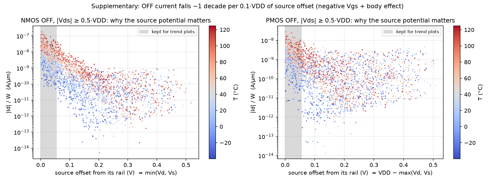); every non-nominal-toxe sample triggers BSIM4's 'toxe ≠ toxp + dtox, dtox ignored' warning because the specification varies toxe only; OFF-state body current is a nearly constant ~1e-14 A drain-junction current (no junction area/perimeter in the netlists); OFF-state Id flows against Vds in 28–36 % of samples because channel current and gate-to-drain tunnelling nearly cancel. Full report: `reports/a1_data_quality_report.md`.

## 6. ML model comparison, hyperparameters and selection

Split 70/15/15 per case (7,000 / 1,500 / 1,500) with a fixed seed; scalers fit on training data; tuning and selection on validation only; test sets evaluated once. Features: VDD, T (K), log₁₀W, Vd, Vs, Vds, |Vds|, Vgs, Vgd, Vbs, Vbd, source offset from its rail, the five process parameters relative to nominal (+ asinh(Vds/1 µV) from v2 on). Targets: all four currents jointly, transformed with asinh(I/1 fA) (a signed log that is smooth through zero). Error metric: |I_pred − I_SPICE| / max(|I_SPICE|, 1 fA).

Target-transform study (LightGBM, validation median relative error):

| transform | nmos_off | nmos_on | pmos_off | pmos_on | mean |
|---|---|---|---|---|---|
| sign+log10\|I\| | 6.89 % | 8.11 % | 5.52 % | 8.49 % | 7.25 % |
| asinh(I/1e-15) | 7.82 % | 8.68 % | 5.48 % | 8.78 % | 7.69 % |
| asinh(I/1e-18) | 8.98 % | 9.39 % | 5.92 % | 9.30 % | 8.40 % |
| asinh(I/1e-12) | 9.57 % | 10.93 % | 7.43 % | 11.52 % | 9.86 % |
| asinh(I/1e-09) | 21.73 % | 27.98 % | 13.46 % | 29.31 % | 23.12 % |
| linear | 33.26 % | 34.71 % | 15.10 % | 33.79 % | 29.21 % |

Four model types × four cases (validation, best configuration of each type):

| case | algorithm | R²ₜ | median rel. err | p95 rel. err |
|---|---|---|---|---|
| nmos_off | mlp | 0.9973 | 1.55 % | 9.42 % |
| nmos_off | lightgbm | 0.9906 | 7.15 % | 55.26 % |
| nmos_off | random_forest | 0.9685 | 21.99 % | 122.40 % |
| nmos_off | poly_ridge | 0.9416 | 46.60 % | 318.98 % |
| nmos_on | mlp | 0.9982 | 2.25 % | 12.62 % |
| nmos_on | lightgbm | 0.9971 | 7.94 % | 42.67 % |
| nmos_on | random_forest | 0.9876 | 25.10 % | 186.25 % |
| nmos_on | poly_ridge | 0.9606 | 56.83 % | 8127.03 % |
| pmos_off | mlp | 0.9988 | 1.15 % | 7.02 % |
| pmos_off | lightgbm | 0.9817 | 5.04 % | 54.98 % |
| pmos_off | random_forest | 0.9551 | 18.07 % | 85.03 % |
| pmos_off | poly_ridge | 0.9367 | 38.39 % | 272.38 % |
| pmos_on | mlp | 0.9973 | 2.57 % | 16.52 % |
| pmos_on | lightgbm | 0.9976 | 7.93 % | 44.07 % |
| pmos_on | random_forest | 0.9873 | 26.04 % | 195.66 % |
| pmos_on | poly_ridge | 0.9614 | 56.43 % | 5289.52 % |

* **lightgbm**: best configuration per case chosen on validation from the grid in `scripts/a2_train_models.py` (e.g. `{"n_estimators": 4000, "learning_rate": 0.03, "num_leaves": 63}`).
* **mlp**: best configuration per case chosen on validation from the grid in `scripts/a2_train_models.py` (e.g. `{"hidden": [128, 128, 128], "alpha": 1e-05, "activation": "tanh", "solver": "lbfgs", "max_iter": 3000}`).
* **poly_ridge**: best configuration per case chosen on validation from the grid in `scripts/a2_train_models.py` (e.g. `{"degree": 3, "alpha": 0.01}`).
* **random_forest**: best configuration per case chosen on validation from the grid in `scripts/a2_train_models.py` (e.g. `{"n_estimators": 300, "max_features": 1.0, "min_samples_leaf": 1}`).

The MLP (tanh, three hidden layers of 128) won every case by 3–5×: the currents are smooth exponential functions of the inputs that a smooth network represents well, while trees give piecewise-constant fits over 11 decades and polynomial ridge cannot follow the exponentials.

**Model history and selection rationale.** v1 (A2) used sklearn L-BFGS; v2 (A2b) added the signed-log Vds feature and targeted samples, fixing ON-state Id/Is near Vds = 0 (OFF models were switched to v2 by a disclosed amendment). The improvement phase found that every earlier fit had stopped at sklearn's 3,000-iteration cap with training error ≈ validation error (under-fitting):

| case | hidden | alpha | n_iter | max_iter | train_loss |
|---|---|---|---|---|---|
| nmos_on | (128, 128, 128) | 1e-05 | 3000 | 3000 | 6.56e-05 |
| nmos_off | (128, 128, 128) | 1e-05 | 3000 | 3000 | 4.78e-05 |
| pmos_on | (128, 128, 128) | 1e-05 | 3000 | 3000 | 7.24e-05 |
| pmos_off | (192, 192, 192) | 1e-07 | 3000 | 3000 | 6.63e-05 |

The same network trained with PyTorch full-batch L-BFGS for 15–20k iterations (E2), plus extra targeted data where a train/validation gap appeared (E5), and ensembles (E1, E6), were compared with a validation score declared in advance (mean over the original and targeted validation sets of median + 0.1·p95):

| experiment | nmos_off | nmos_on | pmos_off | pmos_on |
|---|---|---|---|---|
| E0_baseline | 0.0442 | 0.1184 | 0.0459 | 0.1003 |
| E1_ens_v2cache | 0.0384 | 0.0914 | 0.0396 | 0.0834 |
| E2_torch_same | 0.0173 | 0.0655 | 0.0209 | 0.0500 |
| E5_torch_moredata | 0.0120 | 0.0442 | 0.0138 | 0.0294 |
| E6_ens_E2_E5 | 0.0121 | 0.0380 | 0.0157 | 0.0341 |

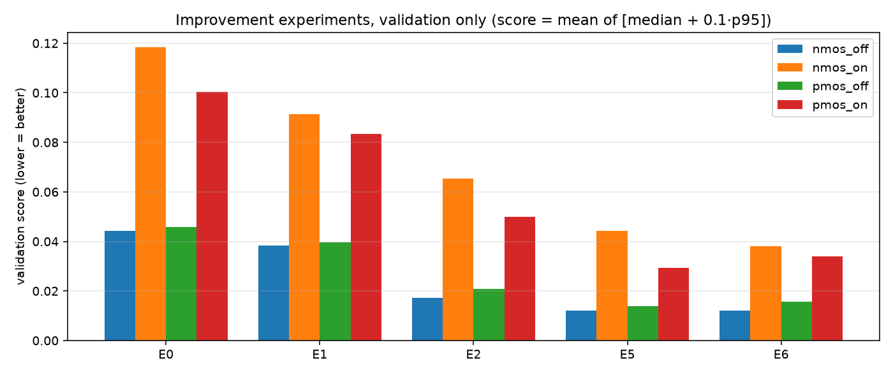

Final models (`trained_models/*.joblib`): nmos_on: E6_ens_E2_E5, nmos_off: E5_torch_moredata, pmos_on: E5_torch_moredata, pmos_off: E5_torch_moredata.

## 7. Transistor prediction results

Final models on the independent test set (1,500 fresh samples per case, specification distribution):

| case | terminal | R²ₜ | median rel. err | p95 rel. err | < 1 % | median abs. err (A) | sign acc. |
|---|---|---|---|---|---|---|---|
| nmos_on | id | 1.00000 | 0.94 % | 4.18 % | 52 % | 1.91e-07 | 100.0 % |
| nmos_on | ig | 0.99997 | 0.29 % | 2.35 % | 86 % | 1.19e-14 | 100.0 % |
| nmos_on | is | 1.00000 | 0.93 % | 4.57 % | 53 % | 1.91e-07 | 100.0 % |
| nmos_on | ib | 0.99999 | 0.35 % | 1.31 % | 89 % | 1.62e-15 | 100.0 % |
| nmos_on | mean | 0.99999 | 0.63 % | 3.10 % | 70 % | 9.55e-08 | 100.0 % |
| nmos_off | id | 0.99981 | 0.77 % | 4.70 % | 60 % | 4.23e-14 | 100.0 % |
| nmos_off | ig | 0.99999 | 0.30 % | 1.15 % | 93 % | 1.58e-14 | 100.0 % |
| nmos_off | is | 0.99884 | 0.89 % | 6.20 % | 54 % | 5.41e-14 | 99.9 % |
| nmos_off | ib | 0.99998 | 0.16 % | 1.15 % | 93 % | 2.33e-17 | 100.0 % |
| nmos_off | mean | 0.99965 | 0.53 % | 3.30 % | 75 % | 2.80e-14 | 100.0 % |
| pmos_on | id | 0.99999 | 1.16 % | 5.62 % | 45 % | 1.39e-07 | 100.0 % |
| pmos_on | ig | 0.99997 | 0.33 % | 2.04 % | 86 % | 7.49e-14 | 100.0 % |
| pmos_on | is | 0.99996 | 1.13 % | 5.59 % | 45 % | 1.48e-07 | 100.0 % |
| pmos_on | ib | 0.99999 | 0.47 % | 1.77 % | 80 % | 1.30e-15 | 100.0 % |
| pmos_on | mean | 0.99998 | 0.77 % | 3.75 % | 64 % | 7.18e-08 | 100.0 % |
| pmos_off | id | 0.99390 | 0.67 % | 5.23 % | 64 % | 9.87e-14 | 99.7 % |
| pmos_off | ig | 0.99998 | 0.31 % | 1.32 % | 92 % | 9.45e-14 | 100.0 % |
| pmos_off | is | 0.99678 | 0.67 % | 5.28 % | 63 % | 1.10e-13 | 99.9 % |
| pmos_off | ib | 0.99996 | 0.38 % | 1.79 % | 86 % | 5.89e-17 | 100.0 % |
| pmos_off | mean | 0.99765 | 0.51 % | 3.40 % | 76 % | 7.58e-14 | 99.9 % |

Mean over cases and terminals: median 0.61 %, p95 3.39 %, mean accuracy 98.56 %. On the near-rail / small-|Vds| test set: median 1.07 %, p95 29.02 % (a mean-based accuracy is not meaningful there because currents cross zero).

Evolution of the transistor-level median error (mean over 4 terminals; v1 on the A2 test split, v1/v2 on the A2b fresh test, before/after on the independent final test):

| case | v1 (A2 test) | v2 (fresh test) | before improvement (final eval) | final (final eval) |
|---|---|---|---|---|
| nmos_on | 2.43 % | 3.53 % | 3.56 % | 0.63 % |
| nmos_off | 1.54 % | 2.07 % | 2.13 % | 0.53 % |
| pmos_on | 2.75 % | 3.52 % | 3.58 % | 0.77 % |
| pmos_off | 1.14 % | 1.82 % | 1.81 % | 0.51 % |

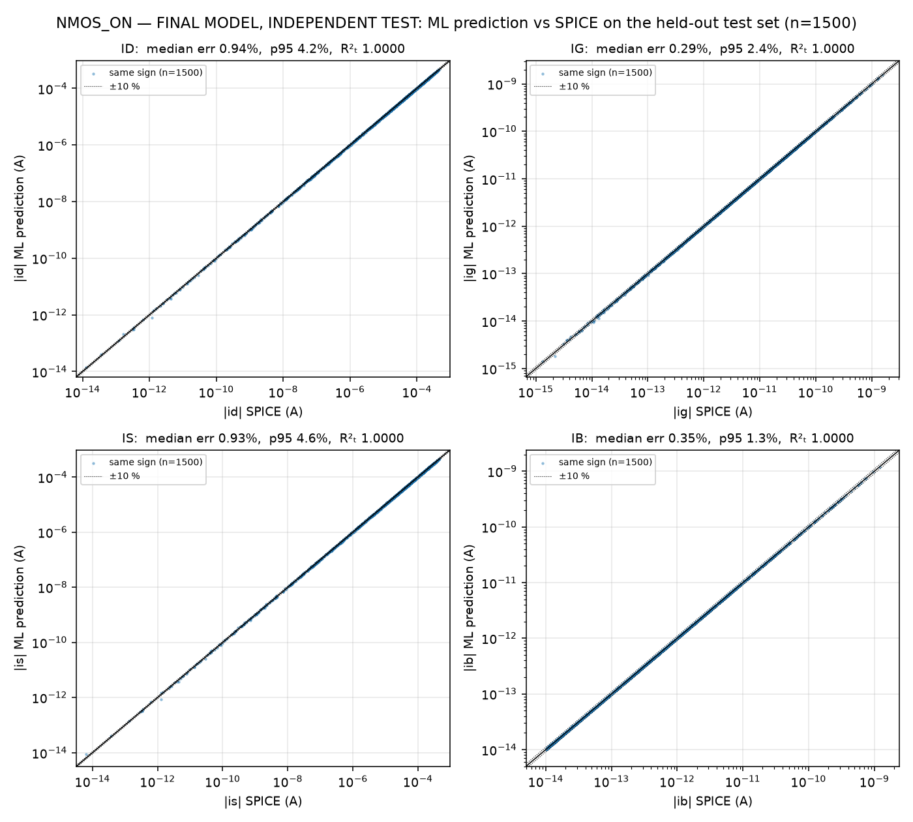
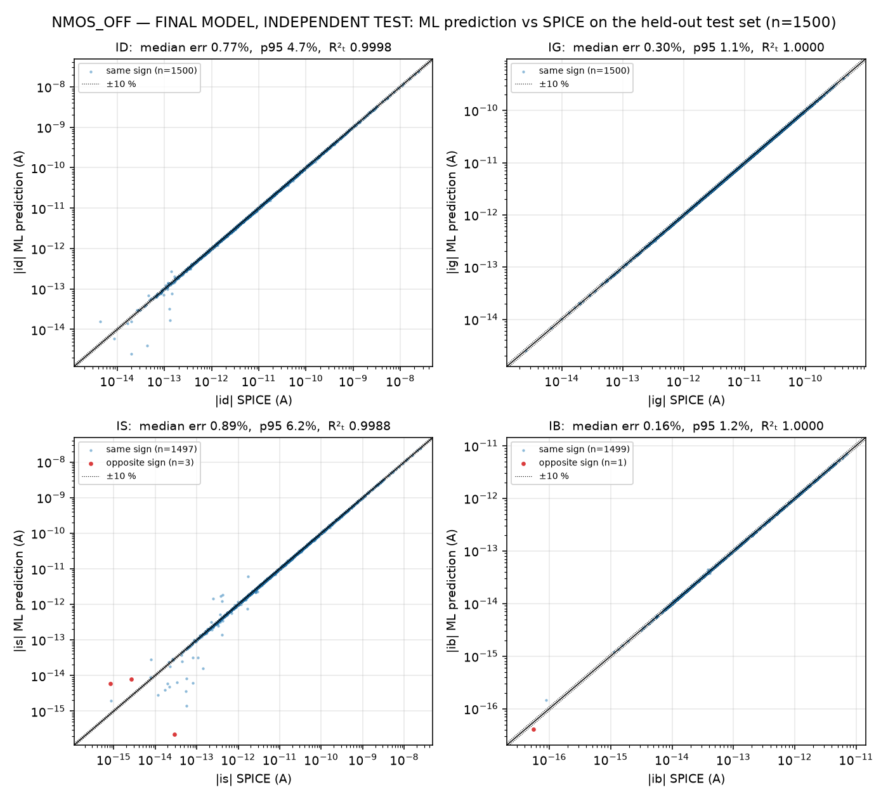
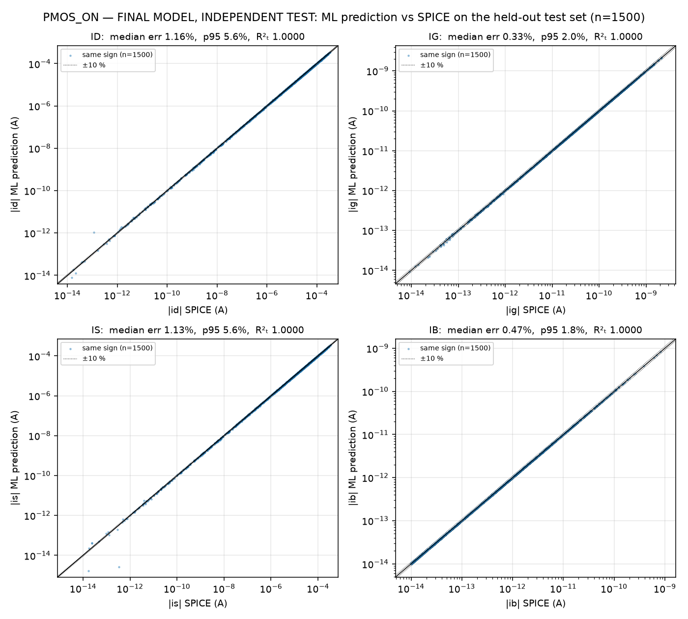
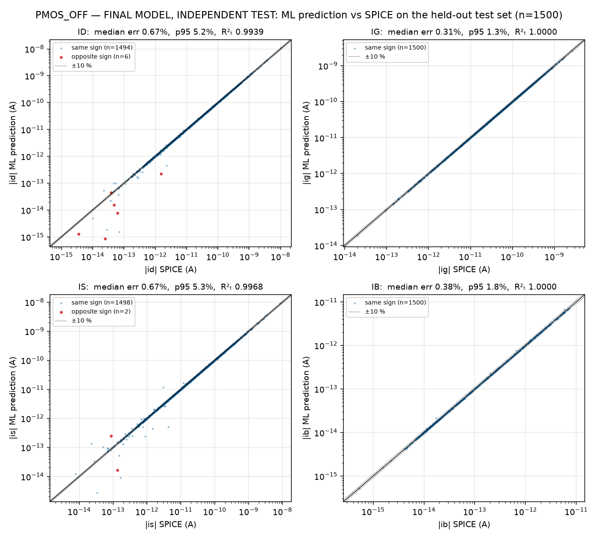

## 8. Gate-level SPICE and ML methodology

Static CMOS gates; AND2/OR2 = NAND2/NOR2 + inverter simulated as one netlist. Sizing (not specified by the PDF): equal-drive sizing, unit inverter Wn = 2Lmin, Wp = 4Lmin, series pairs 2×, all within the ML training range:

| gate | device | type | W (nm) | drain | gate node | source | body |
|---|---|---|---|---|---|---|---|
| INV | mp | PMOS | 180 | out | a | vdd | vdd |
| INV | mn | NMOS | 90 | out | a | 0 | 0 |
| NAND2 | mpa | PMOS | 180 | out | a | vdd | vdd |
| NAND2 | mpb | PMOS | 180 | out | b | vdd | vdd |
| NAND2 | mna | NMOS | 180 | out | a | x | 0 |
| NAND2 | mnb | NMOS | 180 | x | b | 0 | 0 |
| NOR2 | mpa | PMOS | 360 | y | a | vdd | vdd |
| NOR2 | mpb | PMOS | 360 | out | b | y | vdd |
| NOR2 | mna | NMOS | 90 | out | a | 0 | 0 |
| NOR2 | mnb | NMOS | 90 | out | b | 0 | 0 |
| AND2 | mpa | PMOS | 180 | n1 | a | vdd | vdd |
| AND2 | mpb | PMOS | 180 | n1 | b | vdd | vdd |
| AND2 | mna | NMOS | 180 | n1 | a | x | 0 |
| AND2 | mnb | NMOS | 180 | x | b | 0 | 0 |
| AND2 | mpi | PMOS | 180 | out | n1 | vdd | vdd |
| AND2 | mni | NMOS | 90 | out | n1 | 0 | 0 |
| OR2 | mpa | PMOS | 360 | y | a | vdd | vdd |
| OR2 | mpb | PMOS | 360 | n1 | b | y | vdd |
| OR2 | mna | NMOS | 90 | n1 | a | 0 | 0 |
| OR2 | mnb | NMOS | 90 | n1 | b | 0 | 0 |
| OR2 | mpi | PMOS | 180 | out | n1 | vdd | vdd |
| OR2 | mni | NMOS | 90 | out | n1 | 0 | 0 |

200 corners × 18 cases = 3,600 SPICE runs (0 failed, 0 logic errors). Leakage definition: I_leak = Σ_k V_k·(−i(V_k)) / VDD over the VDD rail and the input sources (static power / VDD, includes gate tunnelling drawn from inputs held high). Every transistor terminal has a 0 V probe; Σ V·I over all terminals equals the source power to 1e-6.

ML gate prediction: each transistor's Vd, Vg, Vs, Vb come from its connections — inputs exactly 0/VDD, bodies on the rails, and **internal/output node voltages (out, x, y, n1) taken from the gate SPICE runs, as the PDF permits; the gate predictions therefore depend on SPICE node voltages**. The ON/OFF model is chosen by gate bias; the AND2/OR2 inverter gate (n1, a few µV from a rail) is snapped to the nearest rail. Leakage = Σ over transistors of (Vd−Vs)·Id + (Vg−Vs)·Ig + (Vb−Vs)·Ib, divided by VDD: identical to the SPICE definition by Tellegen's theorem, KCL-consistent per device, and insensitive to ON-channel currents at Vds ≈ 0. Fed with SPICE's own transistor currents this code reproduces the SPICE leakage of all 3,600 cases. Inference runs with subprocess execution blocked (no hidden SPICE).

## 9. Gate results: gate-level accuracy

Final models, all 18 gate/input cases on the Part B corners (overall median 0.75 %, p95 2.80 %, bias -0.072 %, mean accuracy **98.97 %**, R²(log₁₀) 0.99988):

| gate | inputs | SPICE median (A) | ML median (A) | bias | median err | p95 err |
|---|---|---|---|---|---|---|
| INV | 0 | 2.564e-09 | 2.539e-09 | -0.19 % | 0.77 % | 2.48 % |
| INV | 1 | 1.418e-09 | 1.420e-09 | +0.11 % | 0.77 % | 2.86 % |
| NAND2 | 00 | 1.050e-09 | 1.043e-09 | +0.05 % | 0.55 % | 2.03 % |
| NAND2 | 01 | 5.126e-09 | 5.118e-09 | +0.17 % | 0.76 % | 2.40 % |
| NAND2 | 10 | 2.352e-09 | 2.356e-09 | -0.23 % | 0.84 % | 2.52 % |
| NAND2 | 11 | 3.046e-09 | 3.020e-09 | +0.06 % | 0.74 % | 2.72 % |
| NOR2 | 00 | 6.452e-09 | 6.425e-09 | -0.23 % | 0.77 % | 2.36 % |
| NOR2 | 01 | 3.572e-09 | 3.599e-09 | -0.13 % | 0.85 % | 4.26 % |
| NOR2 | 10 | 9.973e-10 | 9.793e-10 | -0.87 % | 1.29 % | 4.06 % |
| NOR2 | 11 | 5.151e-10 | 5.253e-10 | +0.76 % | 1.57 % | 5.53 % |
| AND2 | 00 | 2.627e-09 | 2.631e-09 | +0.04 % | 0.50 % | 2.29 % |
| AND2 | 01 | 7.476e-09 | 7.463e-09 | +0.12 % | 0.66 % | 1.94 % |
| AND2 | 10 | 4.569e-09 | 4.553e-09 | -0.11 % | 0.61 % | 2.00 % |
| AND2 | 11 | 6.618e-09 | 6.631e-09 | -0.09 % | 0.64 % | 2.21 % |
| OR2 | 00 | 8.622e-09 | 8.584e-09 | -0.16 % | 0.68 % | 2.09 % |
| OR2 | 01 | 7.574e-09 | 7.519e-09 | -0.17 % | 0.77 % | 2.62 % |
| OR2 | 10 | 4.280e-09 | 4.220e-09 | -0.37 % | 0.76 % | 2.39 % |
| OR2 | 11 | 3.382e-09 | 3.411e-09 | -0.01 % | 0.77 % | 2.57 % |

Independent new corners: median 0.78 %, p95 3.01 %, mean accuracy **98.93 %**. Most accurate: AND2 00 (0.50 %); NAND2 00 (0.55 %); AND2 10 (0.61 %). Least accurate: NOR2 11 (1.57 %); NOR2 10 (1.29 %); NOR2 01 (0.85 %).

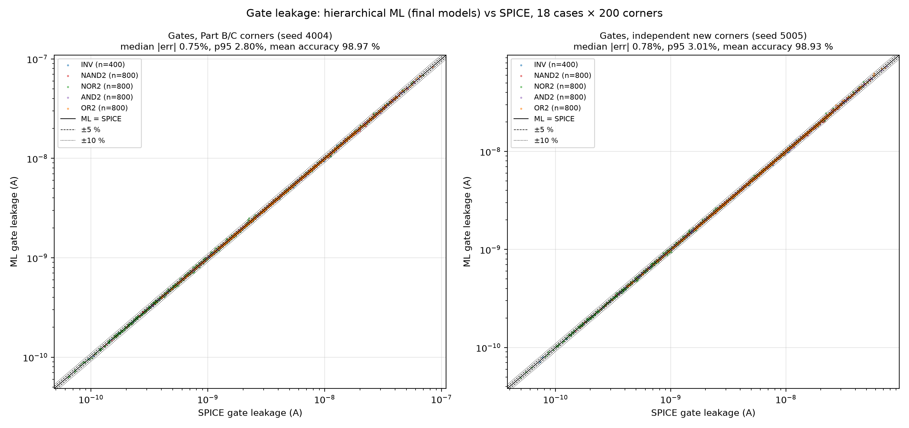

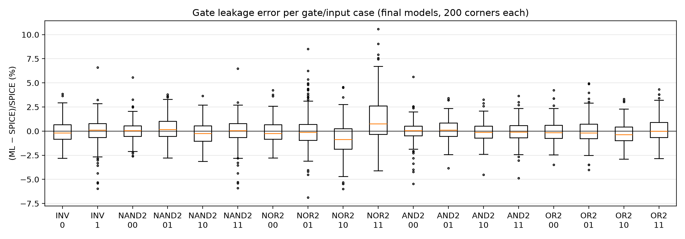

## 10. Larger circuit implementation

Gi = Ai·Bi, Pi = Ai ⊕ Bi, C1 = G0 + P0·C0, C2 = G1 + P1·G0 + P1·P0·C0, C3 = G2 + P2·G1 + P2·P1·G0 + P2·P1·P0·C0 (carry-out), Si = Pi ⊕ Ci. Every carry is computed directly from G/P (verified: no carry depends on another), multi-input terms are trees of 2-input gates, XOR = AND2(OR2, NAND2) with NAND2(Ai, Bi) shared with Gi = INV(·). 36 gates (15 AND2, 12 OR2, 6 NAND2, 3 INV), 192 transistors, identical sizing/bodies/model cards. Cin is tied to logic 0 (all six operand bits exercised → 64 vectors); the Boolean model is verified exhaustively for Cin = 0 and 1. Full-circuit SPICE: 12,800 runs, 0 failed; outputs equal A+B and all 36 internal nets are at their logic levels in every run. Gate list: `data/circuit/cla3_gate_list.csv`; netlist: `netlists/circuit/CLA3.cir`.

ML estimate: a Boolean simulation gives each gate's inputs; each gate's leakage is the gate model of §8 for that gate type / input pattern / corner (gate-internal voltages looked up from the isolated-gate SPICE references, i.e. SPICE-derived); the circuit leakage is the sum over the 36 gates. No full-circuit SPICE quantity is used.

## 11. Test-circuit results: full-circuit accuracy

| corner set | n | SPICE median (A) | ML median (A) | bias | median err | p95 err | R² (log₁₀) | mean accuracy |
|---|---|---|---|---|---|---|---|---|
| Part B/C corners (seed 4004) | 12,800 | 1.892e-07 | 1.884e-07 | -0.106 % | 0.57 % | 1.81 % | 0.99992 | 99.30 % |
| independent new corners (seed 5005) | 12,800 | 1.950e-07 | 1.957e-07 | +0.085 % | 0.57 % | 2.26 % | 0.99988 | 99.24 % |

Mean accuracy = 100 %·(1 − mean |e|), e = (I_ML − I_SPICE)/I_SPICE.

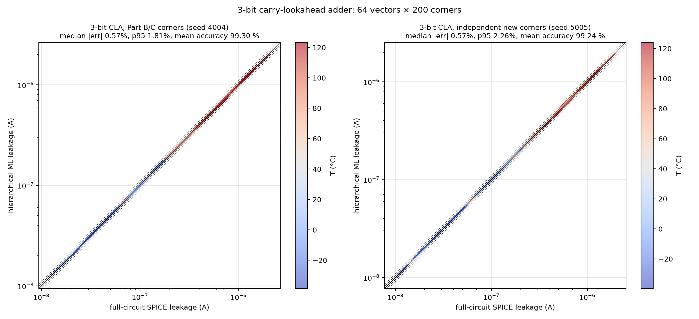

Composition check (no ML): summing the isolated-gate SPICE leakages reproduces the full-circuit SPICE leakage with median error 0.0057 % (p95 0.043 %). Loading between gates is negligible at leakage-level currents, so the circuit error is the transistor-ML error; it is smaller than the gate-level error because the 36 per-gate errors partly cancel.

## 12. Detailed error analysis

* **Transistor level.** Ig and Ib are the easiest terminals (median 0.16 %–0.47 %); Id/Is carry most error (median 0.67 %–1.16 %), worst for ON devices at small |Vds| and for OFF devices where the channel and gate-to-drain currents nearly cancel (zero crossings make relative errors unbounded). Sign accuracy 99.7 %–100.0 %.
* **Optimisation was the dominant limit** of the earlier models (iteration cap, under-fitting); after it was removed, coverage of the near-rail region became the limit, partly fixed with extra targeted data.
* **Gate level.** OFF transistors at rail biases dominate the remaining gate error. Signed error vs temperature (final models, Part B corners): (-40.0, 15.0]: bias -0.03 %, median |e| 0.67 %; (15.0, 70.0]: bias -0.11 %, median |e| 0.75 %; (70.0, 125.01]: bias -0.07 %, median |e| 0.88 %.
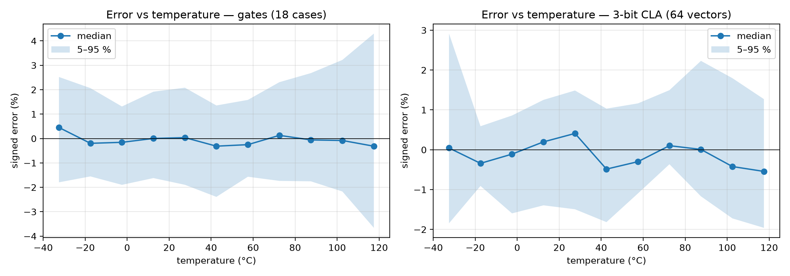
* **SPICE reference integrity.** One new-corner gate record (AND2 00, corner 83) had a spurious operating point: with rbodymod = 1 ngspice's default solve converged to a non-physical internal body-node state (1.07e-8 A instead of 5.28e-10 A). Re-solving every reference with gmin stepping from the start (SPICE only, no ML) flagged only this record:

| set | kind | records | flagged | max_rel_diff |
|---|---|---|---|---|
| data/final_eval/gates | gates | 3600 | 1 | 1.93e+01 |
| data/gates | gates | 3600 | 0 | 5.56e-06 |
| data/final_eval/circuit | CLA3 | 12800 | 0 | 1.07e-05 |
| data/circuit | CLA3 | 12800 | 0 | 9.15e-06 |

  It is corrected in a separate file (original kept); the corrected value is the solution whose transistors match isolated single-transistor SPICE.
* **Before → after the improvement phase** (independent data, corrected reference):

| level | data | models | median err | p95 err | mean accuracy |
|---|---|---|---|---|---|
| gate (18 cases x 200) | NEW corners (seed 5005) | before | 3.80 % | 13.67 % | 95.12 % |
| CLA3 (64 x 200) | NEW corners (seed 5005) | before | 2.98 % | 10.15 % | 96.25 % |
| gate (18 cases x 200) | NEW corners (seed 5005) | after | 0.78 % | 3.01 % | 98.93 % |
| CLA3 (64 x 200) | NEW corners (seed 5005) | after | 0.57 % | 2.26 % | 99.24 % |
| gate (18 cases x 200) | Part B/C corners (seen) | before | 3.38 % | 12.78 % | 95.36 % |
| CLA3 (64 x 200) | Part B/C corners (seen) | before | 2.65 % | 10.62 % | 96.28 % |
| gate (18 cases x 200) | Part B/C corners (seen) | after | 0.75 % | 2.80 % | 98.97 % |
| CLA3 (64 x 200) | Part B/C corners (seen) | after | 0.57 % | 1.81 % | 99.30 % |

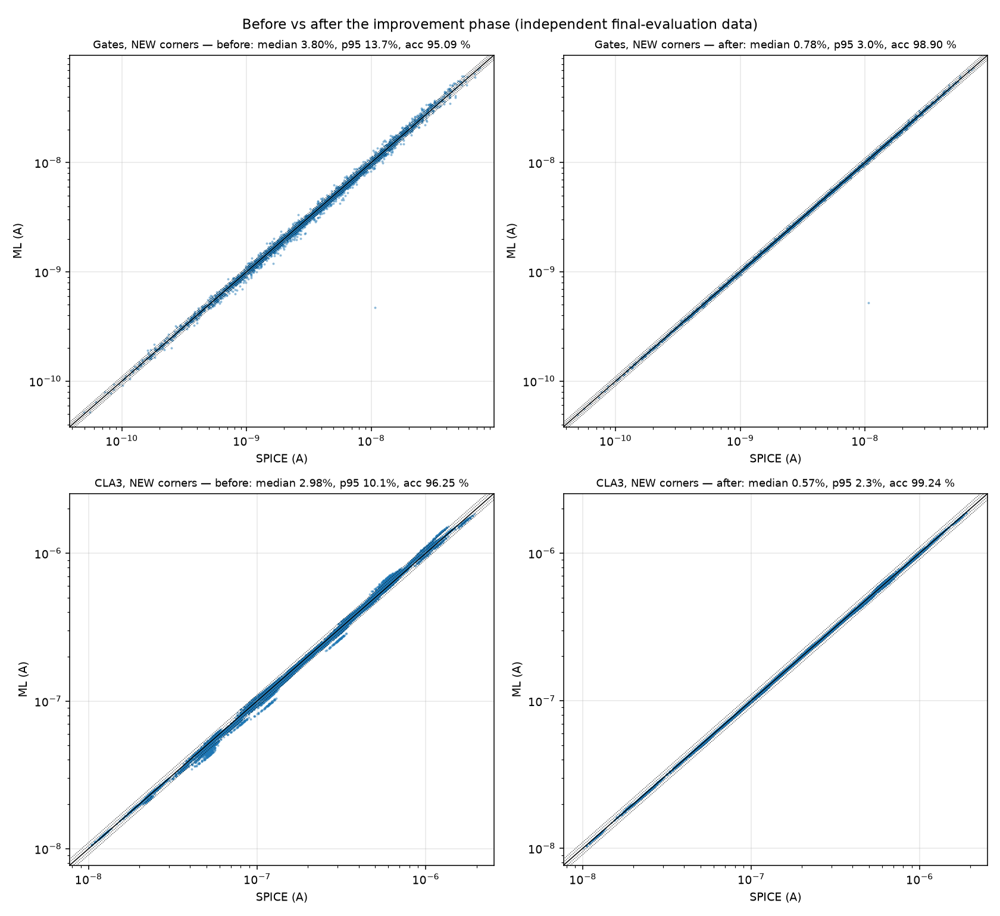

## 13. Limitations and possible improvements

* 99 % mean accuracy is reached at circuit level only; gates are at ~98.9 %, transistors at ~98.6 %. Longer training (some fits still hit the iteration cap), larger seed ensembles and more near-rail data would likely help; each MLP fit costs 1–2 h of CPU on this machine.
* Gate (and therefore circuit) prediction uses SPICE-recorded gate-internal node voltages, as the PDF allows; a fully SPICE-free flow would need a node-voltage model (e.g. solving KCL at internal nodes with the transistor models).
* Specification-inherited model assumptions: only toxe varies (BSIM4 keeps toxp nominal); no junction area/perimeter (body leakage ~1e-14 A, not ∝ W); widths of the gates are an assumption (equal-drive sizing).
* Relative error is ill-defined for currents crossing zero; tail statistics on near-rail data should be read with that in mind.
* Non-unique SPICE operating points (internal body nodes) can corrupt references silently; the uniqueness check should be part of every reference generation.
* Earlier test sets were reused across model versions (disclosed); the primary claims use data created for, and evaluated once in, the final phase.

## 14. Conclusion

A hierarchical, physics-aware ML flow estimates PVT-dependent leakage from transistor to circuit level. With 64k SPICE training samples it predicts the 3-bit carry-lookahead adder's leakage on unseen PVT corners with 0.57 % median error and 99.24 % mean accuracy, and individual gates with 98.93 %, evaluated in milliseconds instead of SPICE runs. The decisive factors were the signed-log target, power-based (Tellegen) gate accounting, fully converged network training, targeted data near the rails, and SPICE reference integrity checks. The 99 % target is met at circuit level and narrowly missed at gate and transistor level.

## 15. References

1. Course project specification, *ML-Driven PVT Variation Aware Leakage Estimation* (`DVD_ML_PROJECT.pdf`).
2. Course slides, *Project-1: Leakage estimation* (annotated), Z. Abbas.
3. Predictive Technology Model (PTM), Arizona State University — 45 nm high-performance metal-gate/high-k model card.
4. BSIM4 MOSFET Model — User's Manual, BSIM Group, University of California, Berkeley.
5. ngspice User's Manual, version 44.
6. F. Pedregosa et al., "Scikit-learn: Machine Learning in Python," *JMLR*, vol. 12, pp. 2825–2830, 2011.
7. A. Paszke et al., "PyTorch: An Imperative Style, High-Performance Deep Learning Library," *NeurIPS*, 2019.
8. G. Ke et al., "LightGBM: A Highly Efficient Gradient Boosting Decision Tree," *NeurIPS*, 2017.
9. D. C. Liu and J. Nocedal, "On the limited memory BFGS method for large scale optimization," *Mathematical Programming*, vol. 45, pp. 503–528, 1989.

## Appendix: reproducibility

`python run_all.py --mode verify | smoke | full` (see `README.md`, `docs/INSTALL_WINDOWS.md`); requirement-to-file map: `reports/deliverables_checklist.md`. Stage reports: `reports/a1_data_quality_report.md`, `reports/a2_ml_report.md`, `reports/a2b_improvement_report.md`, `reports/b4_gate_ml_report.md`, `reports/c_cla3_report.md`, `reports/improvement_report.md`.
