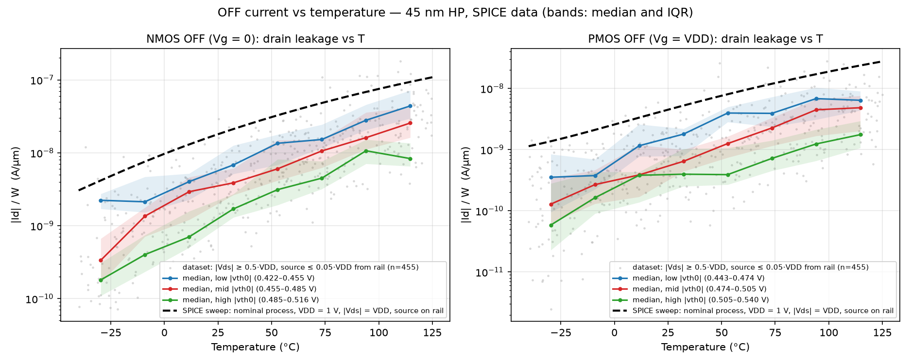
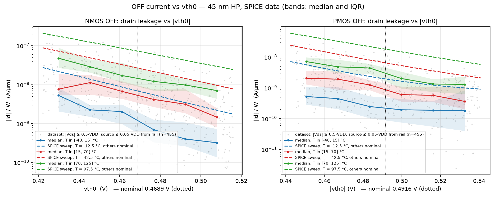
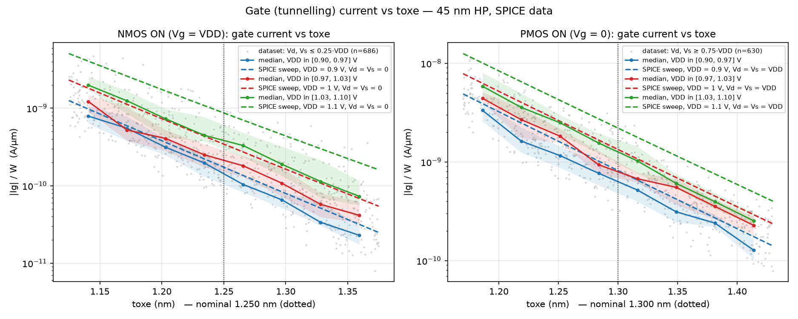

# Part A1 data-quality report

Datasets: `data/transistor/<case>.csv`, 4 cases x 10000 rows, model `models\45nm_HP.pm`, ngspice 44.2, generated 2026-11-12T23:40:04 at git commit `9658349429`. Simulations: 40000 run, 40000 succeeded, 0 failed.

Sign convention: every terminal current is **positive when it flows into the device** (I_X = −i(V_X) from ngspice). Units: A, V, °C, m.

No SPICE value was modified, clipped or removed for this report.

## 1. Completeness and validity

100 of 100 checks pass (none fail). Per case the checks cover: row count = 10,000; exact column order; no NaN/inf; VDD in [0.9, 1.1] V; T in [−40, 125] °C; W in [45, 360] nm; 0 ≤ Vd, Vs ≤ VDD; Vg and Vb follow the case rule; each process parameter within ±10 % of its own device's nominal; unique input rows and sample ids; no exactly-zero currents; Kirchhoff within tolerance; zero failed simulations (failures.csv, metadata).

Full table: `quality_checks.csv`.

## 2. Kirchhoff check: Id + Ig + Is + Ib

| case | n | max_abs_A | median_abs_A | p95_abs_A | max_rel | median_rel | p95_rel | n_over_tolerance | n_abs_over_1fA |
|---|---|---|---|---|---|---|---|---|---|
| nmos_on | 10000 | 1.9e-15 | 7.75e-17 | 3.55e-16 | 0.00997 | 2.62e-12 | 1.27e-07 | 0 | 9 |
| nmos_off | 10000 | 1.87e-23 | 4.19e-27 | 1.89e-25 | 1.18e-14 | 2.84e-16 | 9.37e-16 | 0 | 0 |
| pmos_on | 10000 | 1.86e-16 | 3.03e-17 | 8.78e-17 | 0.00283 | 1.77e-12 | 2.74e-07 | 0 | 0 |
| pmos_off | 10000 | 1.51e-15 | 8.82e-17 | 3.9e-16 | 0.00302 | 1.62e-06 | 6.64e-05 | 0 | 8 |

Tolerance used: |sum| ≤ 1e-06·max|I| + 1e-14 A. **No sample in any case exceeds it.** Interpretation:

* With the into-the-device convention the four currents must sum to zero; signs are already consistent (e.g. NMOS ON: Id > 0, Is < 0).
* Absolute residuals are at the 1e-25 to 1e-15 A level, i.e. at or below the simulator's absolute tolerance scale (abstol = 1e-18 A) and double-precision round-off of the largest terminal current (~1e-16 relative).
* The largest *relative* residuals (up to ~1e-2) occur only in samples where **all four** currents are tiny (≤ ~1e-12 A, typically Vd ≈ Vs): there a fixed residual of ~1e-15 A remains. In Part A1 this was shown not to change with gmin, reltol or vntol, so it is a small non-conservation inside the BSIM4 device evaluation, ~1000x below any leakage of interest.
* No sample was dropped because of KCL.

## 3. Physical trends

Because every input is randomised independently, raw scatter plots hide the trends. The plots therefore (i) normalise by width (A/µm), (ii) condition on the bias that defines the quantity, (iii) show binned medians (with inter-quartile bands) separately for bands of the most influential other variable, and (iv) overlay a **controlled SPICE sweep** (one variable swept, everything else nominal, W = 90 nm). The controlled sweeps are reference simulations only (`controlled_sweeps.csv`), not training data.

### 3.1 Why the OFF-current subset is conditioned on the source potential

A first version conditioned only on |Vds| and its medians sat 1–2 decades below the sweep. Investigation showed this is physics, not an error: with Vd and Vs both random, the effective source is usually *above* its rail (NMOS) or *below* VDD (PMOS). That makes Vgs negative and adds reverse body bias, cutting the sub-threshold current exponentially:

| device | source_offset_vdd | n | median_log10_Id_per_um |
|---|---|---|---|
| nmos | 0.00-0.05 | 53 | -8.44 |
| nmos | 0.05-0.10 | 42 | -9.16 |
| nmos | 0.10-0.20 | 64 | -10.03 |
| nmos | 0.20-0.30 | 56 | -10.65 |
| nmos | 0.30-0.50 | 39 | -10.47 |
| pmos | 0.00-0.05 | 48 | -9.11 |
| pmos | 0.05-0.10 | 37 | -9.72 |
| pmos | 0.10-0.20 | 63 | -10.14 |
| pmos | 0.20-0.30 | 45 | -10.06 |
| pmos | 0.30-0.50 | 32 | -9.94 |

(|Vds| ≥ 0.5·VDD, 20–35 °C.) The current falls about one decade per 0.1·VDD of source offset and saturates near 1e-10.5 A/µm, where other drain components (gate-to-drain tunnelling, junction) dominate. See `fig_supp_off_current_vs_source_offset.png`. The trend plots therefore use |Vds| ≥ 0.5·VDD **and** source within 0.05·VDD of its rail.

### 3.2 Plots

### 3.3 Trend slopes (other inputs held fixed)

| trend | device | unit | dataset_partial_slope | controlled_sweep_slope | expected_sign | dataset_sign_ok | ols_r2 | n |
|---|---|---|---|---|---|---|---|---|
| OFF \|Id\| vs temperature | nmos | decades per 10 C | 0.112 | 0.0933 | + | True | 0.986 | 455 |
| OFF \|Id\| vs \|vth0\| | nmos | decades per 10 mV | -0.115 | -0.113 | - | True | 0.986 | 455 |
| ON \|Ig\| vs toxe | nmos | decades per 0.1 nm | -0.664 | -0.651 | - | True | 0.962 | 686 |
| ON \|Ig\| vs temperature | nmos | decades per 10 C | 0.0146 | nan | ~0 | True | 0.962 | 686 |
| OFF \|Id\| vs temperature | pmos | decades per 10 C | 0.104 | 0.0865 | + | True | 0.886 | 455 |
| OFF \|Id\| vs \|vth0\| | pmos | decades per 10 mV | -0.0988 | -0.108 | - | True | 0.886 | 455 |
| ON \|Ig\| vs toxe | pmos | decades per 0.1 nm | -0.588 | -0.585 | - | True | 0.987 | 630 |
| ON \|Ig\| vs temperature | pmos | decades per 10 C | 0.0033 | nan | ~0 | True | 0.987 | 630 |

`dataset_partial_slope`: OLS of log10(|I|/W) on all inputs within the conditioned subset. `controlled_sweep_slope`: log-linear fit to the SPICE sweep (VDD = 1 V, W = 90 nm; vth0 sweep at 42.5 °C).

### 3.4 Explanation

* **OFF current vs temperature (rises).** Sub-threshold current ∝ exp((Vgs − Vth)/(n·kT/q)): Vth falls with T (kt1 < 0) and the thermal voltage grows, so leakage rises roughly exponentially: the sweep gives 36x (NMOS) and 24x (PMOS) from −40 to 125 °C. The dataset slope agrees in sign and order of magnitude with the controlled sweep.
* **OFF current vs |vth0| (falls).** A higher threshold moves the device deeper into sub-threshold: one decade per n·(kT/q)·ln10 of threshold. Measured on the controlled sweeps at −12.5 / 42.5 / 97.5 °C: NMOS 78 / 89 / 101; PMOS 109 / 92 / 97 mV per decade. For NMOS the sensitivity weakens with temperature as kT/q grows, as expected; for PMOS it is not monotonic over this range (other temperature-dependent terms also enter), but the direction is the same everywhere. The temperature bands are vertically separated by the temperature effect above.
* **Gate current vs toxe (falls steeply).** Direct tunnelling through the oxide decays exponentially with thickness: ~0.6 decades per 0.1 nm here. It also rises with VDD (higher oxide field). It is essentially **temperature-independent** in this model (partial slope ≈ 0, table above) and scales with W (corr(log W, log Ig/W) ≈ 0.04 NMOS / -0.02 PMOS after normalising, i.e. Ig ∝ W).
* All dataset trends have the physically expected sign, and agree with the controlled sweeps. Residual differences in magnitude come from the conditioning windows (|Vds| from 0.5·VDD, source up to 0.05·VDD off its rail, VDD ±10 %), not from the data.

### 3.5 Other observations

* **OFF-state body current is ~1e-14 A and nearly constant.** 66% (NMOS) / 67% (PMOS) of OFF samples have |Ib| between 0.5e-14 and 2e-14 A, almost independent of W (corr(log W, log|Ib|) = 0.11 / 0.12) and of temperature. BSIM4's internal breakdown at the nominal point shows it is the drain–body junction current (ibd ≈ −1.0e-14 A) with the source junction, GIDL, gate-to-body tunnelling and impact ionisation negligible. The netlists, like the supplied example, give no junction area/perimeter (AD/AS/PD/PS), so the junction saturation current is a fixed small value rather than ∝ W. This is genuine SPICE output and is used consistently in the gate and circuit netlists, so it is kept; it is a modelling limitation to note in the report.
* **ON-state body current reaches 4.1e-09 A** at large Vds (consistent with the impact-ionisation substrate current enabled by alpha0/beta0 in the card) — genuine model behaviour.
* Gate current dominates the OFF-state *total* leakage whenever the source is off its rail; the ML models must therefore predict all four terminals, not only Id.
* **OFF-state Id can flow against Vds.** With |Vds| > 0.1 V, 27.9% (NMOS) / 35.7% (PMOS) of OFF samples have Id opposite in sign to Vds. The drain terminal current is the channel current minus the gate-to-drain tunnelling current (opposite directions); when the source is off its rail the channel current collapses and the tunnelling term wins. Id therefore crosses zero away from Vds = 0 as well, and |Id| can dip far below both components.

### 3.6 Simulator-warning audit

All flagged samples plus 10 random unflagged samples per case (131 in total) were re-simulated one per ngspice process so their messages are attributed exactly. 131/131 reproduced the dataset currents to < 1e-9 relative. Messages seen:

| message | samples |
|---|---|
| Warning: toxe, toxp and dtox all given and toxe != toxp + dtox; dtox ignored. | 131 |

**toxe/toxp/dtox warning.** In the 45 nm HP card toxe = toxp + dtox exactly (NMOS 1.25 = 1.00 + 0.25 nm, PMOS 1.30 = 1.00 + 0.30 nm). The specification varies only toxe, so for every sample with a non-nominal toxe (100.00% of NMOS and 100.00% of PMOS samples; the generator recorded the warning for all 10,000 samples of every case) BSIM4 reports the inconsistency and ignores dtox, i.e. the physical oxide thickness toxp stays at its nominal 1.0 nm while the electrical thickness toxe varies. Gate tunnelling follows toxe, as the Ig-vs-toxe plot and slopes confirm; quantities that BSIM4 computes from toxp do not vary. This is a direct consequence of the specified parameter set, applied identically in every transistor, gate and circuit netlist; the warning is benign for this study and is documented as a modelling assumption (alternative: also vary toxp = toxe − dtox).

## 4. Suspicious samples (flagged, not removed)

Screens: (a) Kirchhoff above tolerance; (b) channel current reversed: Id **and** Is both flowing against Vds although |Vds| > 0.1 V (Id alone reversing is common and explained in §3.5; both reversing would mean a wrong channel direction); (c) any |I| < 1e-16 A (within ~100x of abstol, so its relative precision is poor); (d) statistical outliers: 5-fold cross-validated gradient-boosting prediction of log10|I| from all inputs, flag if the residual exceeds both 8 robust standard deviations and 1 decade (Id samples with |Vds| < 0.05 V are skipped there because Id crosses zero at Vds = 0).

| case | reason | count |
|---|---|---|
| nmos_off | ib_below_1e-16A | 2 |
| nmos_off | ib_outlier_vs_neighbours | 2 |
| nmos_off | id_outlier_vs_neighbours | 35 |
| pmos_off | ib_below_1e-16A | 2 |
| pmos_off | ib_outlier_vs_neighbours | 3 |
| pmos_off | id_outlier_vs_neighbours | 45 |
| pmos_off | ig_outlier_vs_neighbours | 1 |
| pmos_on | id_outlier_vs_neighbours | 5 |

All flagged rows with their inputs, currents and the reason are in `suspicious_samples.csv`.

Interpretation:

* `ib_below_*`: OFF samples with both junctions near zero bias (Vd and Vs ≈ 0 for NMOS, ≈ VDD for PMOS) or at low temperature; |Ib| ~ 1e-17 A is physically plausible but numerically fragile. Predicting log|Ib| there needs care (see Part A2).
* `id_outlier_vs_neighbours` (OFF cases): |Id| is 1–2 decades below what neighbouring samples predict because the channel current and the gate-to-drain tunnelling current nearly cancel at the drain (median |Id|/|Ig| ≈ 0.003 among them, Id sign 50/50 vs Vds) — a genuine zero crossing of Id, see §3.5. `ib_/ig_outlier...` and the ON-case flags are the same kind of steep, sign-changing behaviour. Every flagged sample was re-simulated alone (§3.6): values reproduced exactly, no convergence problem, Kirchhoff satisfied. They are kept as valid SPICE data; they mark where an ML model on log|I| will find the data hardest.

## 5. Conclusion

The four datasets are complete (40,000 / 40,000 successful simulations, 0 failures), inside every specified range, free of missing or duplicated values, and satisfy Kirchhoff's law to numerical precision. The three required trends have the physically expected direction and agree with controlled SPICE sweeps once the independently randomised bias is accounted for. The data are fit for training. Points to carry into Part A2: currents span ~11 decades and change sign (Id with Vds, Ig/Ib with bias), so models should predict sign and log-magnitude (or an equivalent transform) per terminal.
