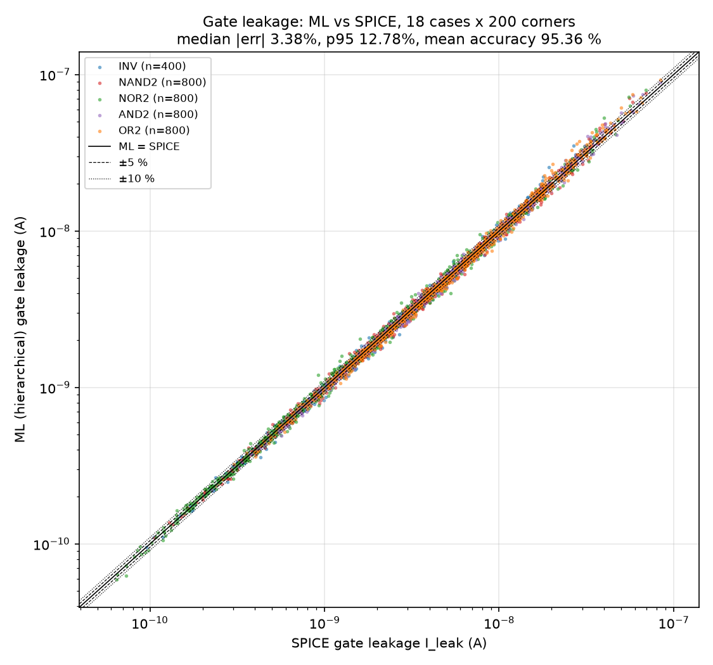
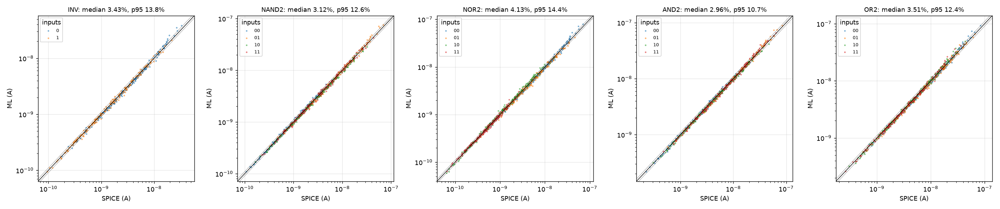
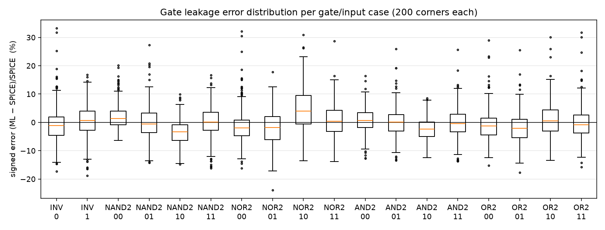

# Part B steps 4–5: hierarchical ML gate leakage vs SPICE

Generated 2026-11-13T12:17:26. 3,600 predictions (18 gate/input cases × 200 corners) from the four transistor ML models (nmos_on: mlp asinh(I/1e-15), nmos_off: mlp asinh(I/1e-15), pmos_on: mlp asinh(I/1e-15), pmos_off: mlp asinh(I/1e-15)). Inference took 0.3 s with subprocess execution blocked: 0 SPICE/subprocess calls were attempted.

**Dependency on SPICE node voltages (allowed by the PDF at this stage):** the internal-node and output voltages (out, x, y, n1) used to set each transistor's terminal voltages are the SPICE-recorded values from Part B step 3. Inputs are exactly 0/VDD and bodies sit on the rails. Only the terminal *currents* come from the ML models; the predictions are therefore not independent of SPICE-generated node voltages.

## Model-selection disclosure

* Change: nmos_off and pmos_off: final model switched from v1 (A2) to v2 (A2b); nmos_on / pmos_on unchanged (v2).
* Reason (validation only): validation-only evidence: on the targeted validation split (near-rail / small-|Vds| samples, where OFF transistors sit inside static gates) the 4-terminal mean p95 relative error is 3.61 (v1) vs 0.30 (v2) for nmos_off and 5.37 (v1) vs 0.40 (v2) for pmos_off, at a cost of +0.5/+0.6 percentage points of median error on the original validation split.
* Disclosure: Decided by the user AFTER the fresh test sets (A2b) and the Part B step 4-5 gate results (with v1 OFF) had been seen; the recommendation itself was made from the validation tails before step 4-5 was run. The Part B results with v1 OFF are archived in results/b4_archive_off_v1/ so both are reported.

| Transistor models | median err | p95 err | bias | mean accuracy |
|---|---|---|---|---|
| v2 ON + v1 OFF (archived) | 4.44% | 21.60% | -2.24% | 93.06 % |
| v2 ON + v2 OFF (final, this report) | 3.38% | 12.78% | -0.59% | 95.36 % |

## Method

* ON/OFF model per transistor by gate bias (NMOS ON: Vg = VDD; PMOS ON: Vg = 0). AND2/OR2 inverters are driven by n1, a few µV from a rail (max snap 3.24e-04 V); they are classified by the nearest rail and the model input is snapped to it. A gate-biased-ON transistor whose source sits at an intermediate node (e.g. NAND2 '10', MNA with source at x ≈ 0.77 V) still uses the ON model, whose training data covers sources anywhere in [0, VDD].
* Leakage accounting: I_leak = Σ_transistors [(Vd−Vs)·Id + (Vg−Vs)·Ig + (Vb−Vs)·Ib] / VDD, i.e. total device power / VDD. This equals the SPICE definition (power delivered by the VDD rail and the input sources, / VDD) by Tellegen's theorem. Using the source as reference enforces KCL per device and counts every terminal once; an ON transistor's channel current only enters through its tiny Vds. Verified: the same code fed with SPICE's own per-transistor currents reproduces the SPICE leakage of all 3,600 cases (`tests/test_gate_ml.py`). VDD-rail and input-source currents are included through the total power; they are also computed directly as diagnostics.
* Error per sample e = (I_ML − I_SPICE)/I_SPICE; bias = median(e); median error = median|e|; p95 error = 95th percentile of |e|; mean accuracy = 100 %·(1 − mean|e|).

## Results: all 18 gate/input cases

| gate | inputs | spice_median_A | ml_median_A | bias | median_err | p95_err | mean_accuracy_pct | frac_within_5pct |
|---|---|---|---|---|---|---|---|---|
| INV | 0 | 2.564e-09 | 2.572e-09 | -1.19% | 3.23% | 14.16% | 94.89 | 63.50% |
| INV | 1 | 1.418e-09 | 1.381e-09 | +0.62% | 3.46% | 13.32% | 95.36 | 63.50% |
| NAND2 | 00 | 1.05e-09 | 1.048e-09 | +1.30% | 2.37% | 11.98% | 96.47 | 77.00% |
| NAND2 | 01 | 5.126e-09 | 5.213e-09 | -0.63% | 3.46% | 12.99% | 95.37 | 65.50% |
| NAND2 | 10 | 2.352e-09 | 2.328e-09 | -3.32% | 4.08% | 12.39% | 95.26 | 63.00% |
| NAND2 | 11 | 3.046e-09 | 2.888e-09 | +0.14% | 3.14% | 13.05% | 95.62 | 67.00% |
| NOR2 | 00 | 6.452e-09 | 6.333e-09 | -1.94% | 3.69% | 12.96% | 94.88 | 63.50% |
| NOR2 | 01 | 3.572e-09 | 3.536e-09 | -1.76% | 3.98% | 14.37% | 94.74 | 59.00% |
| NOR2 | 10 | 9.973e-10 | 1.073e-09 | +4.04% | 5.79% | 16.47% | 93.13 | 45.50% |
| NOR2 | 11 | 5.151e-10 | 4.969e-10 | +0.41% | 3.70% | 10.65% | 95.58 | 64.50% |
| AND2 | 00 | 2.627e-09 | 2.669e-09 | +0.73% | 2.79% | 10.25% | 96.44 | 76.50% |
| AND2 | 01 | 7.476e-09 | 7.64e-09 | +0.13% | 2.94% | 12.02% | 95.91 | 71.50% |
| AND2 | 10 | 4.569e-09 | 4.427e-09 | -2.34% | 3.38% | 10.17% | 96.06 | 70.50% |
| AND2 | 11 | 6.618e-09 | 6.528e-09 | -0.43% | 3.19% | 12.47% | 95.76 | 67.50% |
| OR2 | 00 | 8.622e-09 | 8.236e-09 | -1.20% | 3.41% | 12.38% | 95.48 | 66.00% |
| OR2 | 01 | 7.574e-09 | 7.437e-09 | -2.08% | 3.48% | 13.17% | 95.28 | 62.00% |
| OR2 | 10 | 4.28e-09 | 4.181e-09 | +0.54% | 3.86% | 12.42% | 95.00 | 60.00% |
| OR2 | 11 | 3.382e-09 | 3.314e-09 | -0.80% | 3.33% | 12.28% | 95.26 | 64.00% |

**Overall (3,600):** median |err| 3.38%, p95 12.78%, bias -0.59%, mean accuracy **95.36 %**, 65.0% of predictions within ±5 %.

## Per gate

| gate | n | bias | median_err | p95_err | mean_accuracy_pct |
|---|---|---|---|---|---|
| INV | 400 | -0.005032 | 0.0343 | 0.138 | 95.12 |
| NAND2 | 800 | -0.006092 | 0.03118 | 0.1258 | 95.68 |
| NOR2 | 800 | -0.002286 | 0.04132 | 0.1435 | 94.58 |
| AND2 | 800 | -0.005137 | 0.02964 | 0.1073 | 96.04 |
| OR2 | 800 | -0.009857 | 0.03513 | 0.1243 | 95.26 |

**Most accurate cases:** NAND2 00 (median 2.37%, p95 12.0%); AND2 00 (median 2.79%, p95 10.3%); AND2 01 (median 2.94%, p95 12.0%).

**Least accurate cases:** NOR2 10 (median 5.79%, p95 16.5%); NAND2 10 (median 4.08%, p95 12.4%); NOR2 01 (median 3.98%, p95 14.4%).

## Error analysis

Transistor-level accuracy inside the gates (ML vs SPICE currents at identical terminal voltages):

| model_case | terminal | n | median_rel_err | p95_rel_err |
|---|---|---|---|---|
| nmos_on | id | 4200 | 0.2001 | 2.223 |
| nmos_on | ig | 4200 | 0.0293 | 0.09874 |
| nmos_on | ib | 4200 | 0.03023 | 0.08766 |
| nmos_off | id | 4200 | 0.06932 | 0.5085 |
| nmos_off | ig | 4200 | 0.01798 | 0.2524 |
| nmos_off | ib | 4200 | 0.04196 | 0.9422 |
| pmos_on | id | 4200 | 0.2986 | 5.437 |
| pmos_on | ig | 4200 | 0.02251 | 0.08524 |
| pmos_on | ib | 4200 | 0.03603 | 0.1351 |
| pmos_off | id | 4200 | 0.05905 | 0.3198 |
| pmos_off | ig | 4200 | 0.02112 | 0.5492 |
| pmos_off | ib | 4200 | 0.07978 | 1.143 |

Spearman correlation of the signed gate error with: temp +0.20, vdd +0.17, n_vth0 +0.02, p_vth0 -0.14. Error by temperature and VDD bin: `error_by_condition.csv`.

Which transistor dominates the gate error (mean share of |ΔP|):

| gate | inputs | top_device_by_mean_share |
|---|---|---|
| AND2 | 00 | ('mpi', 'pmos_off') |
| AND2 | 01 | ('mna', 'nmos_off') |
| AND2 | 10 | ('mnb', 'nmos_off') |
| AND2 | 11 | ('mni', 'nmos_off') |
| INV | 0 | ('mn', 'nmos_off') |
| INV | 1 | ('mp', 'pmos_off') |
| NAND2 | 00 | ('mna', 'nmos_off') |
| NAND2 | 01 | ('mna', 'nmos_off') |
| NAND2 | 10 | ('mnb', 'nmos_off') |
| NAND2 | 11 | ('mpb', 'pmos_off') |
| NOR2 | 00 | ('mnb', 'nmos_off') |
| NOR2 | 01 | ('mpb', 'pmos_off') |
| NOR2 | 10 | ('mpa', 'pmos_off') |
| NOR2 | 11 | ('mpb', 'pmos_off') |
| OR2 | 00 | ('mnb', 'nmos_off') |
| OR2 | 01 | ('mpb', 'pmos_off') |
| OR2 | 10 | ('mni', 'nmos_off') |
| OR2 | 11 | ('mni', 'nmos_off') |

Diagnostic, not the reported metric: computing leakage directly from the predicted VDD-rail and input currents gives median |err| 9.29% and p95 40.9%; it depends on the ON transistors' channel currents at Vds ≈ 0 and on per-device KCL, which the power formulation avoids.

Worst 20 samples: `worst_20_cases.csv`. Data: `data/gates/gate_ml_predictions.csv`, `data/gates/gate_ml_devices.csv`.
