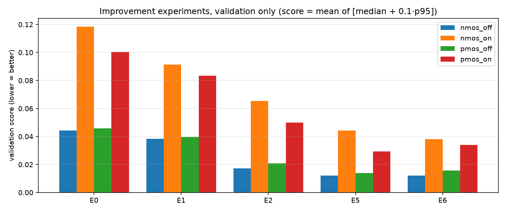
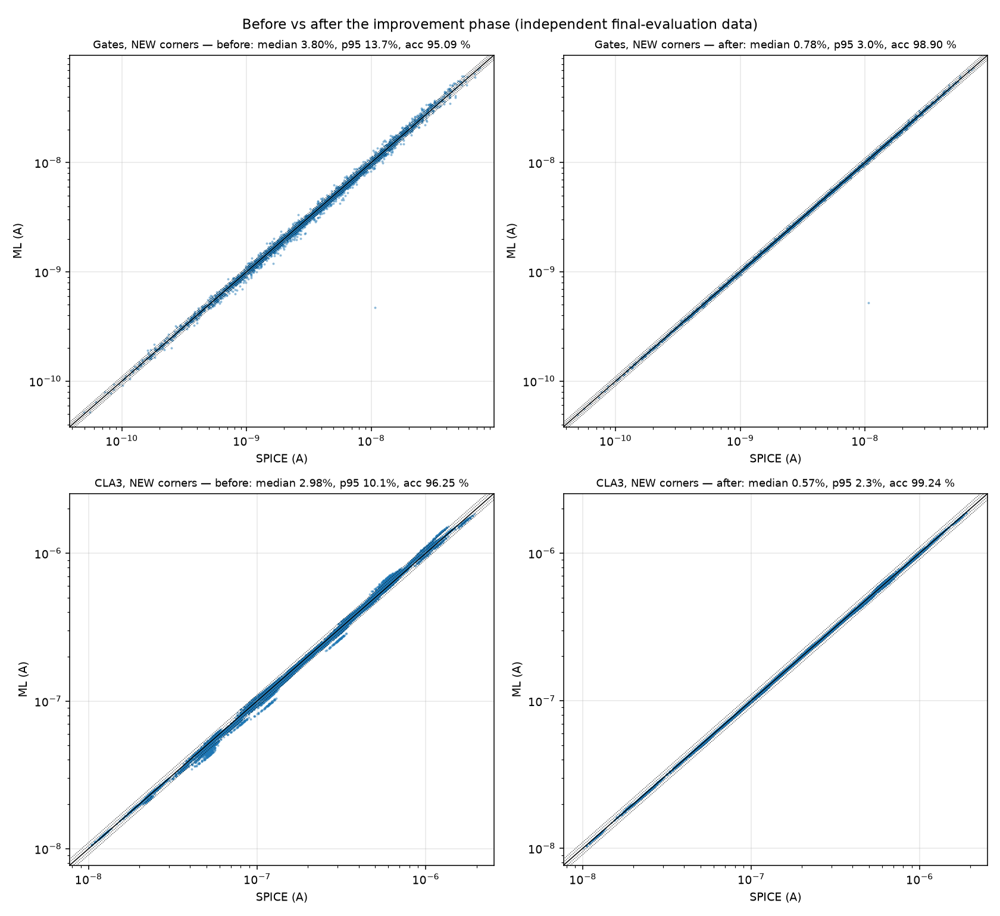

# Accuracy and reliability improvement phase

All numbers in this report are measured. The protocol (data roles and the validation selection score) was fixed in `results/improve/selection_rule.md` before any experiment ran. Original result files are unchanged; the previous final models are archived in `trained_models/final_before_improvement/`.

## 1. Diagnosis (training / validation data only)

**Optimisation.** Every previous final model stopped at sklearn's 3,000-iteration L-BFGS cap:

| case | hidden | alpha | n_iter | max_iter | train_loss |
|---|---|---|---|---|---|
| nmos_on | (128, 128, 128) | 1e-05 | 3000 | 3000 | 6.56e-05 |
| nmos_off | (128, 128, 128) | 1e-05 | 3000 | 3000 | 4.78e-05 |
| pmos_on | (128, 128, 128) | 1e-05 | 3000 | 3000 | 7.24e-05 |
| pmos_off | (192, 192, 192) | 1e-07 | 3000 | 3000 | 6.63e-05 |

**Under- vs over-fitting** (median relative error, mean over terminals):

| case | train | val_orig | val_targeted |
|---|---|---|---|
| nmos_off | 2.01% | 2.03% | 2.83% |
| nmos_on | 3.90% | 3.51% | 7.01% |
| pmos_off | 1.73% | 1.72% | 2.47% |
| pmos_on | 3.89% | 3.58% | 7.57% |

Training ≈ validation error for the previous models → they were under-fitted, not data-starved.
Other checks (`results/improve/diagnostics/`):
* Sign conventions: sign accuracy 98.7–100 % on validation; no convention problem.
* Convergence: all training/validation SPICE samples converged. One new-corner gate reference (AND2 01, corner 198, 119.5 °C) needed a retry with raised DC iteration limits (tolerances unchanged); the simulator now does this automatically and records it.
* Small magnitudes: |I| < 10 fA samples (mostly OFF-state Ib) make up 60 % of the Ib error tail; relative error there is large but the absolute error is negligible.
* Coverage: error grows ~30 % from the nearest to the farthest quartile of distance to training data.
* Gate/circuit composition (Parts B/C): SPICE gate sums reproduce the full-circuit SPICE leakage to 0.006 % median, and the gate accounting reproduces SPICE leakage exactly when fed SPICE currents, so the SPICE-assisted node voltages, ideal-logic composition and current aggregation are not error sources; the error is the transistor ML error.

## 2. Experiments (validation only)

* **E0** – current final (v2; sklearn L-BFGS, stopped at 3,000 iterations)
* **E1** – mean of the 3 existing v2 MLPs (no new training)
* **E2** – same MLP, PyTorch L-BFGS, 15,000 iterations
* **E5** – E2 + extra targeted training data (salt 6), 20,000 iterations
* **E6** – mean of E2 and E5

Validation score per case (lower is better; pre-declared rule):

| experiment | nmos_off | nmos_on | pmos_off | pmos_on |
|---|---|---|---|---|
| E0 | 0.0442 | 0.1184 | 0.0459 | 0.1003 |
| E1 | 0.0384 | 0.0914 | 0.0396 | 0.0834 |
| E2 | 0.0173 | 0.0655 | 0.0209 | 0.0500 |
| E5 | 0.0120 | 0.0442 | 0.0138 | 0.0294 |
| E6 | 0.0121 | 0.0380 | 0.0157 | 0.0341 |

After the longer optimisation (E2) the training error fell well below validation error on the *targeted* (near-rail, small-|Vds|) samples (e.g. NMOS ON median 1.0 % train vs 2.1 % val, p95 5 % vs 98 %), i.e. a coverage gap appeared; that evidence motivated a modest batch of extra targeted transistor-level training samples (E5: +4,000 per ON case, +2,000 per OFF case, new seed). Validation sets were kept fixed.

**Selected models (`trained_models/v3/`):**

| case | selected | validation score | baseline score | reduction |
|---|---|---|---|---|
| nmos_on | E6_ens_E2_E5 | 0.0380 | 0.1184 | 68% |
| nmos_off | E5_torch_moredata | 0.0120 | 0.0442 | 73% |
| pmos_on | E5_torch_moredata | 0.0294 | 0.1003 | 71% |
| pmos_off | E5_torch_moredata | 0.0138 | 0.0459 | 70% |

| case | val_orig median | val_orig p95 | val_targeted median | val_targeted p95 |
|---|---|---|---|---|
| nmos_on | 3.51% → 0.62% | 15.40% → 3.28% | 7.01% → 1.43% | 116.31% → 52.25% |
| nmos_off | 2.03% → 0.50% | 9.94% → 3.02% | 2.83% → 0.56% | 29.78% → 10.33% |
| pmos_on | 3.58% → 0.81% | 14.71% → 3.79% | 7.57% → 1.59% | 74.34% → 31.06% |
| pmos_off | 1.72% → 0.49% | 9.71% → 3.61% | 2.47% → 0.63% | 40.22% → 12.74% |

## 3. Before / after (one-time final evaluation)

PRIMARY = data created for this phase and evaluated once (fresh transistor tests; 200 new PVT corners, seed 5005, with new gate and CLA SPICE references). SECONDARY = sets already seen in earlier parts.

| level | data | independent? | median err | p95 err | mean accuracy | bias | R² (log10) |
|---|---|---|---|---|---|---|---|
| transistor (mean of 4 cases, 4 terminals) | transistor targeted (A2b test2, seen) | no (seen) | 5.00% → **1.04%** | 69.86% → **29.70%** | -73.04 % → **62.34 %** | – | – |
| transistor (mean of 4 cases, 4 terminals) | transistor targeted (new) | yes (new) | 5.16% → **1.07%** | 68.01% → **29.02%** | -518.15 % → **76.48 %** | – | – |
| transistor (mean of 4 cases, 4 terminals) | transistor uniform (A2b test2, seen) | no (seen) | 2.73% → **0.62%** | 12.47% → **3.31%** | 95.58 % → **97.98 %** | – | – |
| transistor (mean of 4 cases, 4 terminals) | transistor uniform (new) | yes (new) | 2.77% → **0.61%** | 12.03% → **3.39%** | 95.46 % → **98.56 %** | – | – |
| gate (18 cases x 200) | NEW corners (seed 5005) | yes (new) | 3.80% → **0.78%** | 13.68% → **3.01%** | 95.09 % → **98.90 %** | -0.46% → +0.09% | 0.9957 → 0.9983 |
| CLA3 (64 x 200) | NEW corners (seed 5005) | yes (new) | 2.98% → **0.57%** | 10.14% → **2.26%** | 96.25 % → **99.24 %** | -1.03% → +0.09% | 0.9972 → 0.9999 |
| gate (18 cases x 200) | Part B/C corners (seen) | no (seen) | 3.38% → **0.75%** | 12.78% → **2.80%** | 95.36 % → **98.97 %** | -0.59% → -0.07% | 0.9978 → 0.9999 |
| CLA3 (64 x 200) | Part B/C corners (seen) | no (seen) | 2.65% → **0.57%** | 10.62% → **1.81%** | 96.28 % → **99.30 %** | -0.81% → -0.11% | 0.9977 → 0.9999 |

Transistor level, new test sets, per case (mean over the 4 terminals):

| dataset | case | mean_med after | mean_med before | mean_p95 after | mean_p95 before |
|---|---|---|---|---|---|
| transistor targeted (new) | nmos_off | 0.63% | 2.99% | 10.14% | 33.85% |
| transistor targeted (new) | nmos_on | 1.37% | 7.67% | 53.00% | 126.13% |
| transistor targeted (new) | pmos_off | 0.74% | 2.72% | 20.65% | 39.10% |
| transistor targeted (new) | pmos_on | 1.54% | 7.24% | 32.29% | 72.98% |
| transistor uniform (new) | nmos_off | 0.53% | 2.13% | 3.30% | 10.06% |
| transistor uniform (new) | nmos_on | 0.63% | 3.56% | 3.10% | 14.62% |
| transistor uniform (new) | pmos_off | 0.51% | 1.81% | 3.40% | 10.13% |
| transistor uniform (new) | pmos_on | 0.77% | 3.58% | 3.75% | 13.32% |

Per-terminal median error after improvement (new test sets, averaged over uniform and targeted):

| case | id_med | ig_med | is_med | ib_med |
|---|---|---|---|---|
| nmos_off | 0.80% | 0.35% | 0.89% | 0.27% |
| nmos_on | 1.66% | 0.37% | 1.60% | 0.38% |
| pmos_off | 0.79% | 0.37% | 0.82% | 0.53% |
| pmos_on | 1.84% | 0.39% | 1.92% | 0.48% |

Gate level after improvement, new corners, all 18 cases:

| gate | inputs | spice_median | ml_median | bias | median_err | p95_err |
|---|---|---|---|---|---|---|
| AND2 | 00 | 3.023e-09 | 3.027e-09 | +0.15% | 0.70% | 2.44% |
| AND2 | 01 | 7.874e-09 | 7.863e-09 | +0.27% | 0.71% | 2.60% |
| AND2 | 10 | 4.494e-09 | 4.470e-09 | -0.03% | 0.70% | 2.43% |
| AND2 | 11 | 6.899e-09 | 6.920e-09 | +0.13% | 0.69% | 2.49% |
| INV | 0 | 2.735e-09 | 2.776e-09 | +0.13% | 0.75% | 2.59% |
| INV | 1 | 1.524e-09 | 1.530e-09 | +0.27% | 0.96% | 3.74% |
| NAND2 | 00 | 1.162e-09 | 1.162e-09 | +0.07% | 0.57% | 1.75% |
| NAND2 | 01 | 5.583e-09 | 5.587e-09 | +0.28% | 0.81% | 3.01% |
| NAND2 | 10 | 2.592e-09 | 2.582e-09 | -0.23% | 0.82% | 2.52% |
| NAND2 | 11 | 3.208e-09 | 3.214e-09 | +0.22% | 0.95% | 3.63% |
| NOR2 | 00 | 7.033e-09 | 7.006e-09 | +0.13% | 0.68% | 2.42% |
| NOR2 | 01 | 4.175e-09 | 4.188e-09 | +0.01% | 0.95% | 4.56% |
| NOR2 | 10 | 1.050e-09 | 1.031e-09 | -0.69% | 1.23% | 4.10% |
| NOR2 | 11 | 5.722e-10 | 5.826e-10 | +0.97% | 1.55% | 5.40% |
| OR2 | 00 | 9.496e-09 | 9.518e-09 | +0.06% | 0.60% | 2.53% |
| OR2 | 01 | 8.180e-09 | 8.177e-09 | +0.05% | 0.71% | 2.60% |
| OR2 | 10 | 4.299e-09 | 4.302e-09 | -0.17% | 0.68% | 2.01% |
| OR2 | 11 | 3.601e-09 | 3.614e-09 | +0.33% | 0.71% | 2.53% |

Most accurate: NAND2 00 (0.57%); OR2 00 (0.60%); OR2 10 (0.68%). Least accurate: NOR2 11 (1.55%); NOR2 10 (1.23%); INV 1 (0.96%).

### 3.1 SPICE reference integrity: operating-point uniqueness

One new-corner gate record (AND2 '00', corner 83) stood out in the parity plot for both model sets. Investigation showed a **spurious SPICE operating point**: with rbodymod = 1 the BSIM4 devices have internal body nodes, and ngspice's default solve converged to a non-physical state (1.07e-8 A, a 1e-8 A circulating body current in an ON PMOS whose isolated-transistor body current is 2e-13 A). Starting the solve with gmin stepping (`.options noopiter`) or from logic-level node voltages gives 5.28e-10 A, and every transistor then matches an isolated single-transistor simulation at the same terminal voltages (max deviation 0.3 % vs 1.5e5 for the default solution).

Every reference was re-solved with the alternative start-up path (SPICE only; the ML models were not used for detection or correction). Records whose leakage changes by > 0.1 % are flagged:

| set | kind | records | flagged | max_rel_diff |
|---|---|---|---|---|
| data/final_eval/gates | gates | 3600 | 1 | 1.93e+01 |
| data/gates | gates | 3600 | 0 | 5.56e-06 |
| data/final_eval/circuit | CLA3 | 12800 | 0 | 1.07e-05 |
| data/circuit | CLA3 | 12800 | 0 | 9.15e-06 |

Transistor training/validation data: 3,200 sampled points re-solved — max difference 6e-11, i.e. not affected. The single flagged record was corrected in `data/final_eval/gates/gate_spice_results_corrected.csv` (original kept).

Gate level, new corners, with the corrected reference: before 3.80% median / 95.12 % accuracy → after 0.78% / **98.93 %**, R²(log10) 0.9999 (CLA results unchanged: no CLA record was flagged).

## 4. Was the 99 % mean-accuracy target reached? (mean accuracy = 100 %·(1 − mean |relative error|), independent new data, improved models)

- gate (18 cases x 200): 98.90 % → **not reached**
- CLA3 (64 x 200): 99.24 % → **reached**
- transistor level, spec-distribution test set (mean over 4 cases × 4 terminals): 98.56 % → **not reached**
- transistor level, near-rail/small-|Vds| test set: median error 1.07%, p95 29.0%. A mean-based accuracy is not meaningful there (76.5 %): currents crossing zero make individual relative errors unbounded even when absolute errors are femtoamps.

## 5. Remaining limitations

* **Optimisation still not fully converged** for some fits (iteration cap reached); longer training and seed ensembles would likely help further, at hours of CPU per model on this machine.
* **Near-rail / small-|Vds| region** (where gate transistors sit) still has the longest error tails; the train/validation gap there shrank with more targeted data but did not close.
* **Zero-crossing currents**: Id/Is pass through zero (Vds = 0, and OFF-state cancellation between channel and gate-drain tunnelling). Relative error is undefined there and inflates tail statistics even when absolute errors are femtoamps.
* **Model assumptions inherited from the spec / netlists**: only toxe is varied (BSIM4 keeps toxp nominal, warning on every sample); no junction area/perimeter (body leakage ~1e-14 A fixed); gate evaluation uses SPICE-recorded internal node voltages (allowed by the PDF).
* **Evaluation-set reuse**: earlier test sets were seen before this phase; the primary before/after numbers therefore use the new, untouched final-evaluation data.
