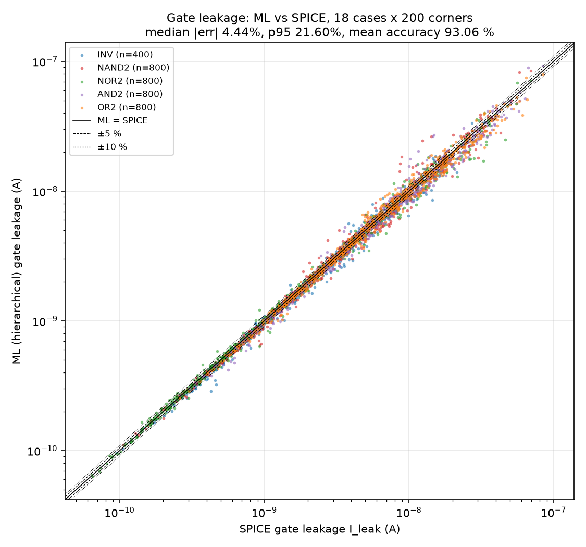
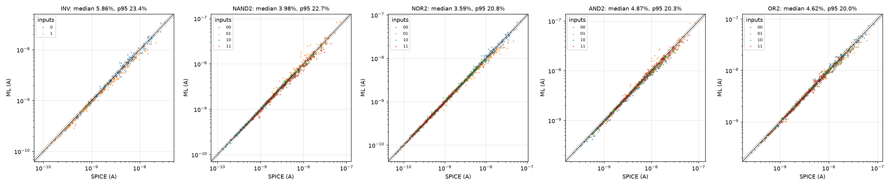
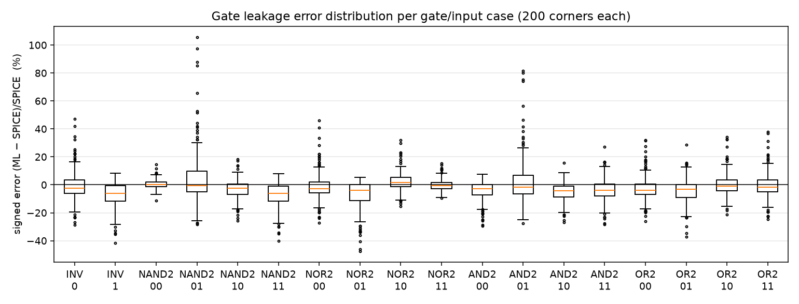

# Part B steps 4–5: hierarchical ML gate leakage vs SPICE

Generated 2026-11-13T12:13:23. 3,600 predictions (18 gate/input cases × 200 corners) from the four transistor ML models (nmos_on: mlp asinh(I/1e-15), nmos_off: mlp asinh(I/1e-15), pmos_on: mlp asinh(I/1e-15), pmos_off: mlp asinh(I/1e-15)). Inference took 0.2 s with subprocess execution blocked: 0 SPICE/subprocess calls were attempted.

**Dependency on SPICE node voltages (allowed by the PDF at this stage):** the internal-node and output voltages (out, x, y, n1) used to set each transistor's terminal voltages are the SPICE-recorded values from Part B step 3. Inputs are exactly 0/VDD and bodies sit on the rails. Only the terminal *currents* come from the ML models; the predictions are therefore not independent of SPICE-generated node voltages.

## Method

* ON/OFF model per transistor by gate bias (NMOS ON: Vg = VDD; PMOS ON: Vg = 0). AND2/OR2 inverters are driven by n1, a few µV from a rail (max snap 3.24e-04 V); they are classified by the nearest rail and the model input is snapped to it. A gate-biased-ON transistor whose source sits at an intermediate node (e.g. NAND2 '10', MNA with source at x ≈ 0.77 V) still uses the ON model, whose training data covers sources anywhere in [0, VDD].
* Leakage accounting: I_leak = Σ_transistors [(Vd−Vs)·Id + (Vg−Vs)·Ig + (Vb−Vs)·Ib] / VDD, i.e. total device power / VDD. This equals the SPICE definition (power delivered by the VDD rail and the input sources, / VDD) by Tellegen's theorem. Using the source as reference enforces KCL per device and counts every terminal once; an ON transistor's channel current only enters through its tiny Vds. Verified: the same code fed with SPICE's own per-transistor currents reproduces the SPICE leakage of all 3,600 cases (`tests/test_gate_ml.py`). VDD-rail and input-source currents are included through the total power; they are also computed directly as diagnostics.
* Error per sample e = (I_ML − I_SPICE)/I_SPICE; bias = median(e); median error = median|e|; p95 error = 95th percentile of |e|; mean accuracy = 100 %·(1 − mean|e|).

## Results: all 18 gate/input cases

| gate | inputs | spice_median_A | ml_median_A | bias | median_err | p95_err | mean_accuracy_pct | frac_within_5pct |
|---|---|---|---|---|---|---|---|---|
| INV | 0 | 2.564e-09 | 2.567e-09 | -2.48% | 5.46% | 23.01% | 92.33 | 46.00% |
| INV | 1 | 1.418e-09 | 1.324e-09 | -6.16% | 6.69% | 25.70% | 91.25 | 40.00% |
| NAND2 | 00 | 1.05e-09 | 1.045e-09 | +0.20% | 1.94% | 6.24% | 97.58 | 89.50% |
| NAND2 | 01 | 5.126e-09 | 5.454e-09 | -0.46% | 6.84% | 39.21% | 88.15 | 40.00% |
| NAND2 | 10 | 2.352e-09 | 2.395e-09 | -2.49% | 3.64% | 16.94% | 94.39 | 60.50% |
| NAND2 | 11 | 3.046e-09 | 2.741e-09 | -6.11% | 6.48% | 23.25% | 91.49 | 40.50% |
| NOR2 | 00 | 6.452e-09 | 6.369e-09 | -2.97% | 5.13% | 20.66% | 92.72 | 47.50% |
| NOR2 | 01 | 3.572e-09 | 3.418e-09 | -4.03% | 4.28% | 29.57% | 91.34 | 52.00% |
| NOR2 | 10 | 9.973e-10 | 1.046e-09 | +1.52% | 3.34% | 13.48% | 95.07 | 64.00% |
| NOR2 | 11 | 5.151e-10 | 5.132e-10 | -0.58% | 2.43% | 8.21% | 96.91 | 81.00% |
| AND2 | 00 | 2.627e-09 | 2.506e-09 | -2.62% | 3.09% | 18.73% | 94.57 | 65.00% |
| AND2 | 01 | 7.476e-09 | 7.97e-09 | -1.66% | 6.63% | 30.70% | 89.90 | 43.50% |
| AND2 | 10 | 4.569e-09 | 4.499e-09 | -4.38% | 4.82% | 17.17% | 93.54 | 52.50% |
| AND2 | 11 | 6.618e-09 | 6.457e-09 | -3.80% | 5.54% | 19.73% | 92.73 | 46.00% |
| OR2 | 00 | 8.622e-09 | 8.633e-09 | -3.97% | 5.37% | 18.85% | 92.83 | 45.00% |
| OR2 | 01 | 7.574e-09 | 7.287e-09 | -3.07% | 4.64% | 21.61% | 92.64 | 53.00% |
| OR2 | 10 | 4.28e-09 | 4.439e-09 | -0.94% | 3.91% | 18.33% | 94.34 | 62.50% |
| OR2 | 11 | 3.382e-09 | 3.502e-09 | -1.85% | 4.50% | 19.50% | 93.38 | 56.50% |

**Overall (3,600):** median |err| 4.44%, p95 21.60%, bias -2.24%, mean accuracy **93.06 %**, 54.7% of predictions within ±5 %.

## Per gate

| gate | n | bias | median_err | p95_err | mean_accuracy_pct |
|---|---|---|---|---|---|
| INV | 400 | -0.03861 | 0.05857 | 0.234 | 91.79 |
| NAND2 | 800 | -0.01487 | 0.03976 | 0.2267 | 92.9 |
| NOR2 | 800 | -0.01282 | 0.03588 | 0.2084 | 94.01 |
| AND2 | 800 | -0.03177 | 0.04867 | 0.2035 | 92.69 |
| OR2 | 800 | -0.02467 | 0.04617 | 0.1999 | 93.3 |

**Most accurate cases:** NAND2 00 (median 1.94%, p95 6.2%); NOR2 11 (median 2.43%, p95 8.2%); AND2 00 (median 3.09%, p95 18.7%).

**Least accurate cases:** NAND2 01 (median 6.84%, p95 39.2%); INV 1 (median 6.69%, p95 25.7%); AND2 01 (median 6.63%, p95 30.7%).

## Error analysis

Transistor-level accuracy inside the gates (ML vs SPICE currents at identical terminal voltages):

| model_case | terminal | n | median_rel_err | p95_rel_err |
|---|---|---|---|---|
| nmos_on | id | 4200 | 0.2001 | 2.223 |
| nmos_on | ig | 4200 | 0.0293 | 0.09874 |
| nmos_on | ib | 4200 | 0.03023 | 0.08766 |
| nmos_off | id | 4200 | 0.0861 | 22.21 |
| nmos_off | ig | 4200 | 0.01963 | 12.69 |
| nmos_off | ib | 4200 | 0.1934 | 22.01 |
| pmos_on | id | 4200 | 0.2986 | 5.437 |
| pmos_on | ig | 4200 | 0.02251 | 0.08524 |
| pmos_on | ib | 4200 | 0.03603 | 0.1351 |
| pmos_off | id | 4200 | 0.08688 | 20.92 |
| pmos_off | ig | 4200 | 0.02431 | 68.26 |
| pmos_off | ib | 4200 | 0.1467 | 38.62 |

Spearman correlation of the signed gate error with: temp -0.12, vdd -0.10, n_vth0 -0.16, p_vth0 -0.08. Error by temperature and VDD bin: `error_by_condition.csv`.

Which transistor dominates the gate error (mean share of |ΔP|):

| gate | inputs | top_device_by_mean_share |
|---|---|---|
| AND2 | 00 | ('mpi', 'pmos_off') |
| AND2 | 01 | ('mna', 'nmos_off') |
| AND2 | 10 | ('mpi', 'pmos_off') |
| AND2 | 11 | ('mni', 'nmos_off') |
| INV | 0 | ('mn', 'nmos_off') |
| INV | 1 | ('mp', 'pmos_off') |
| NAND2 | 00 | ('mna', 'nmos_off') |
| NAND2 | 01 | ('mna', 'nmos_off') |
| NAND2 | 10 | ('mnb', 'nmos_off') |
| NAND2 | 11 | ('mpa', 'pmos_off') |
| NOR2 | 00 | ('mnb', 'nmos_off') |
| NOR2 | 01 | ('mpb', 'pmos_off') |
| NOR2 | 10 | ('mpa', 'pmos_off') |
| NOR2 | 11 | ('mpb', 'pmos_off') |
| OR2 | 00 | ('mnb', 'nmos_off') |
| OR2 | 01 | ('mpb', 'pmos_off') |
| OR2 | 10 | ('mni', 'nmos_off') |
| OR2 | 11 | ('mni', 'nmos_off') |

Diagnostic, not the reported metric: computing leakage directly from the predicted VDD-rail and input currents gives median |err| 10.73% and p95 40.9%; it depends on the ON transistors' channel currents at Vds ≈ 0 and on per-device KCL, which the power formulation avoids.

Worst 20 samples: `worst_20_cases.csv`. Data: `data/gates/gate_ml_predictions.csv`, `data/gates/gate_ml_devices.csv`.
