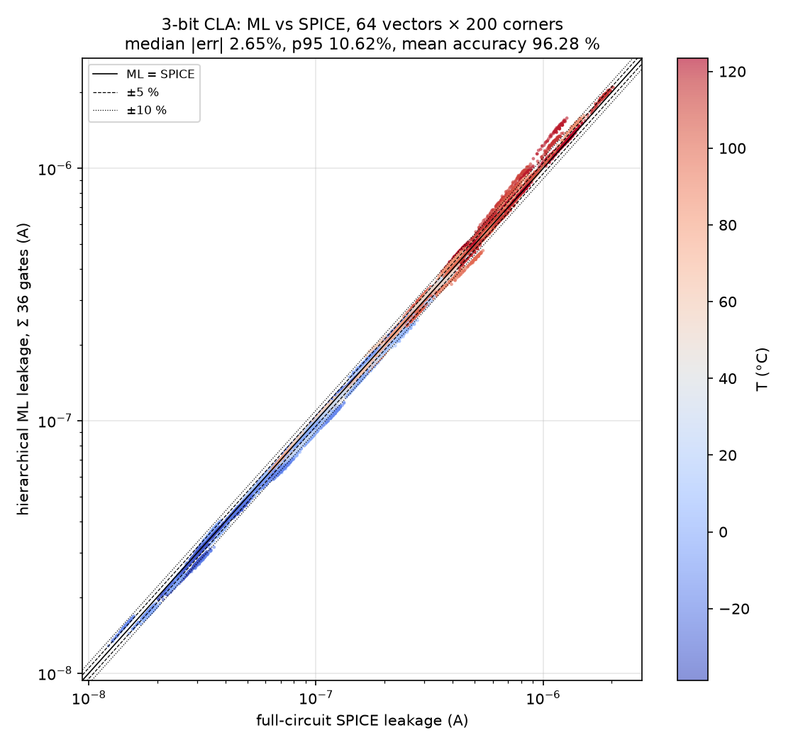
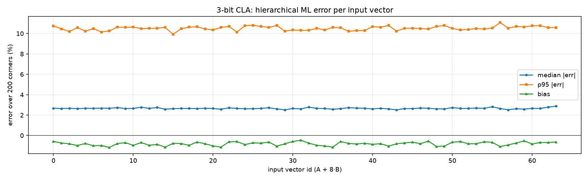

# Part C: 3-bit carry-lookahead adder — hierarchical ML vs full-circuit SPICE

Generated 2026-11-13T13:33:10.

## Circuit

Lookahead logic with C0 = Cin: Gi = Ai·Bi, Pi = Ai ⊕ Bi, C1 = G0 + P0·C0, C2 = G1 + P1·G0 + P1·P0·C0, C3 = G2 + P2·G1 + P2·P1·G0 + P2·P1·P0·C0 (Cout), Si = Pi ⊕ Ci. Only INV / NAND2 / AND2 / OR2 are needed (NOR2 unused); XOR(x,y) = AND2(OR2(x,y), NAND2(x,y)) with NAND2(Ai,Bi) shared by Gi = INV(·) and Pi. 36 gates (15 AND2, 12 OR2, 6 NAND2, 3 INV), 192 transistors, same widths / bodies / model cards / corner process draws as Part B. Gate list: `data/circuit/cla3_gate_list.csv`; complete netlist: `netlists/circuit/CLA3.cir`.

**Carry-in assumption:** Cin tied to logic 0 (0 V source); all 6 operand bits exercised → 64 vectors. The Boolean model is verified exhaustively for Cin = 0 and 1 (128 cases, `tests/test_circuit.py`); SPICE confirms A+B at the outputs and every internal net at its logic level for all 12,800 runs.

## Method

* SPICE reference: complete transistor netlist, I_leak = Σ_k V_k·(−i(V_k)) / VDD over the VDD rail and the input sources (same definition as Part B), 64 vectors × 200 Part B corners.
* ML: Boolean simulation gives each gate's inputs; each gate's leakage comes from the Part B gate model (four transistor ML models, power accounting). **Gate-internal node voltages are looked up from the Part B isolated-gate SPICE references** for the same gate type / input pattern / corner — this lookup is SPICE-derived. **No full-circuit SPICE quantity is used:** the ML function only takes (vector, corner). Prediction ran with subprocess blocked (0 attempts) in 1.57 s.
* Errors: e = (I_ML − I_SPICE)/I_SPICE; bias = median(e); median / p95 of |e|; mean accuracy = 100 %·(1 − mean|e|); R² on log10(I) and on I.

## Results (64 vectors × 200 corners = 12,800)

| comparison | n | spice_median_A | ml_median_A | bias | median_err | p95_err | max_err | mean_accuracy_pct | frac_within_5pct | r2_log10 | r2_linear |
|---|---|---|---|---|---|---|---|---|---|---|---|
| hierarchical ML vs full-circuit SPICE (REPORTED) | 12800 | 1.892e-07 | 1.847e-07 | -0.81% | 2.65% | 10.62% | 26.28% | 96.28 | 73.71% | 0.9977 | 0.9891 |
| diag: sum of Part B SPICE gate leakages vs full-circuit SPICE | 12800 | 1.892e-07 | 1.892e-07 | -0.01% | 0.01% | 0.04% | 0.11% | 99.99 | 100.00% | 1 | 1 |
| diag: hierarchical ML vs sum of SPICE gate leakages | 12800 | 1.892e-07 | 1.847e-07 | -0.80% | 2.65% | 10.62% | 26.31% | 96.27 | 73.70% | 0.9977 | 0.989 |

Compared with isolated-gate validation (Part B, 3,600 cases): median 3.38%, p95 12.78%, mean accuracy 95.36 %.

Best vectors: A=5, B=3 (2.51%); A=3, B=5 (2.51%); A=1, B=7 (2.52%). Worst vectors: A=7, B=7 (2.87%); A=7, B=6 (2.82%); A=0, B=4 (2.79%). Spearman correlation of the signed error with temp +0.41, vdd +0.23, n_vth0 +0.06, p_vth0 -0.10.

## Why circuit-level accuracy differs from isolated-gate accuracy

1. **Composition (no ML involved):** the hierarchical sum assumes every gate input sits exactly at 0/VDD from an ideal source and ignores loading. In the circuit, gate inputs are driven by other gates' outputs, which sit slightly off the rails (up to tens of µV here) and supply the fan-out's gate-tunnelling current through their ON transistors. The diagnostic row 'sum of Part B SPICE gate leakages vs full-circuit SPICE' isolates this effect.
2. **ML error per gate:** each of the 36 gate estimates carries the Part B error. Random errors partly average out in the sum (36 terms), but any common bias (e.g. from the same transistor model case at the same corner) adds coherently, because all gates share one process draw and temperature per corner.
3. The two effects combine; the third table row shows the ML-only part relative to the SPICE gate sum.

**Measured here:** the composition error is negligible (median 0.0057%, p95 0.043%): with leakage-level currents the internal nets sit within 0.03 % of VDD of the rails, so loading barely changes any gate's operating point. Practically all circuit error is the transistor-ML error (2.65% median vs the SPICE gate sum). The circuit-level error (2.65% median, 10.6% p95) is *smaller* than the isolated-gate error (3.38%, 12.8%) because the 36 per-gate errors partly cancel in the sum; what survives is their common component — the bias (-0.81%) and its temperature dependence (Spearman ρ(e, T) = +0.41: the ML sum is low at cold corners and closer/high at hot ones). So the PDF's expected accuracy loss from loading did not materialise for this circuit at this sizing; correlated per-gate bias is the limiting factor.

Data: `data/circuit/cla3_spice_results.csv` (SPICE), `data/circuit/cla3_ml_predictions.csv` (ML, per vector × corner), `results/c/cla3_per_vector.csv`, `results/c/cla3_gate_case_usage.csv`.
